# Week2 实验报告

## 摘要
本报告记录了第 2 周实验的全过程，内容包括 Linux 基础命令练习、Python 与 C++ 编程、小型项目的编译运行、ROS (Noetic) 的安装与验证、Catkin 工作空间与功能包管理，以及基于 turtlesim 的机器人模拟与控制。文中对关键命令、实现步骤、运行截图与遇到的问题进行了整理，并给出了解决方法与后续改进方向。

## 实验环境
- 操作系统：Ubuntu / Debian 系列（以 Ubuntu 20.04 / WSL 或等价环境为参考）
- ROS 版本：ROS Noetic
- Python：Python 3
- 编译器：g++ (GNU C++ Compiler)
- 其它工具：VSCode、catkin、rqt 系列工具
---

## 一.实验任务
### 1.Linux基础命令练习
- 创建/移动/删除文件
- apt 安装软件
- 使用 ps 与 kill 查看并终止进程
### 2.Python与C++编程练习
- Python HelloWorld
- C++ 简单程序（输入数字求和）
- VSCode 调试
- g++ 编译
### 3.ROS1安装验证
- roscore 启动
- rosnode list 
- ROS 环境变量
### 4.CATKIN工作空间与功能包
- catkin_ws 创建与 catkin_make 编译
- beginner_tutorials 功能包
- HelloWorld 节点运行
### 5.Turtlesim小乌龟基础
 **5.1 键盘控制**
- turtlesim 窗口
- teleop_key 控制
**5.2 rostopic 控制**
- rostopic pub /cmd_vel 
- 小乌龟运动轨迹
**5.3 程序控制小乌龟**
- Python/C++ 源码
- 运行截图（画圆）
### 6.多乌龟launch+rqt_graph
- 创建一个 launch 文件
- 同时启动 2 只以上乌龟
- 每只乌龟具有不同命名空间
- 使用 rostopic 分别控制两只乌龟
- 使用 rqt_graph 绘制通信关系图
- 使用 rqt_plot 绘制乌龟速度图
---
## 二.实现过程
### 1.Linux基础命令练习
#### 1）文件管理（我这里以week2.txt为例）
（1）导航与查看

    pwd：显示当前工作目录的绝对路径，例：pwd -- /home/li/桌面；
    cd [目录]：切换目录，例：cd /home/li/下载（跳转到指定目录,比如说下载）、cd ..（返回上一级）、cd ~（进入用户家目录）；
    ls ：列出目录内容

（2）创建与删除

    touch创建空文件: touch week2.txt；
    mkdir创建目录: mkdir week2_dir（创建名为week2_dir的文件夹）；mkdir -p week2/work/note （递归创建多级目录）（如 mkdir -p ~/Projects/cppdemo）
    rm 删除文件/目录：rm week2.txt（删除week2.txt文件），-f 强制删除（不提示），-r 递归删除目录（例：rm -rf old_dir/，谨慎使用，避免误删系统文件）。
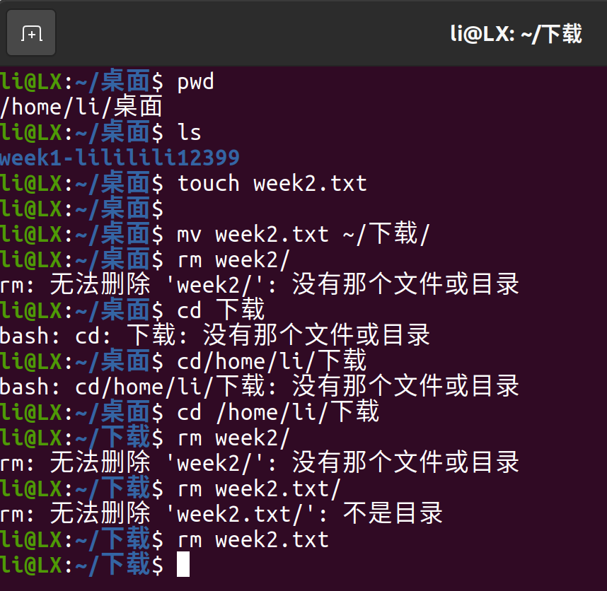[遇见问题1](#删除文件)

（3）复制与移动

    cp 复制文件/目录: cp week2.txt backup(把week2.txt复制到backup文件夹);cp -r 用于复制目录 cp -r week2/ week2_dir_backup/（复制week2_dir文件夹到week2_dir_backup）；
    mv 移动或重命名文件： mv old.txt new.txt（重命名）、mv week2.txt ~/下载/（移动文件，将week2从桌面移动到下载）。

（4）内容查看与编辑

    cat 查看文件全部内容：cat week2.txt（直接显示week2.txt的全部内容）；
    less 分页查看大文件（按 q 退出，/关键词 搜索内容）：less week2.txt；
    nano/vim 文本编辑器：nano week2.txt（用nano打开week2.txt，Ctrl+O 保存，Ctrl+X 退出）；vim week2.txt（用vim打开，按i 进入编辑模式，Esc 退出，:wq 保存出）。


#### 2）权限管理
（1）文件权限修改
   
    ls -l # 查看文件权限
    chmod +x hello.txt # 给文件添加可执行权限
    chmod 777 hello.txt # 修改文件所有权限为 777（读/写/执行全开放）


（2）用户与组管理（需 root 权限）

    useradd [用户名]：创建用户，例：useradd newuser；
    passwd [用户名]：设置用户密码，例：passwd newuser；
    userdel [用户名]：删除用户，-r 选项同时删除用户家目录（例：userdel -r olduser）；
    groupadd [组名]/groupdel [组名]：创建/删除用户组；
    usermod -aG [组名] [用户名]：将用户加入指定组，例：usermod -aG sudo newuser（赋予用户 sudo 管理员权限）。

#### 3）进程管理
（1）查看系统状态

    df -h：查看磁盘空间使用情况（-h 人类可读格式）；
    free -h：查看内存使用情况（总内存、已用、空闲）；
    top/htop：实时监控进程与系统资源（top 为基础工具，htop 界面更直观，需额外安装）；
    uname -a：查看内核版本与硬件架构；
    hostname：查看主机名；
    date：显示当前系统时间；
    uptime：查看系统运行时间与负载（1 分钟/5 分钟/15 分钟平均负载）。

（2）进程管理

    ps：查看进程，ps aux 显示系统所有进程（a 所有用户，u 详细信息，x 后台进程）；
    kill [进程ID]：终止进程，-9 选项强制终止（例：kill -9 1234，慎用，可能导致数据丢失）；
    pkill [进程名]：按名称终止进程，例：pkill firefox（终止所有 Firefox 进程）；
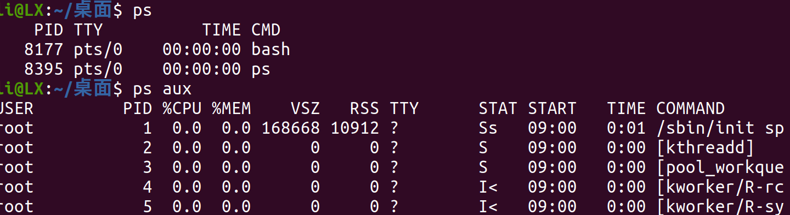
我这里选4010作为尝试
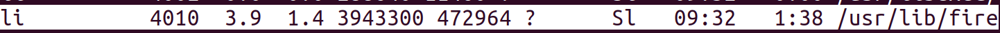
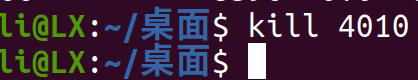
#### 4）软件安装
Debian/Ubuntu 系列（apt 工具）

    sudo apt update：更新软件源索引；
    sudo apt install [软件名]：安装软件，例：sudo apt install nginx；
    sudo apt remove [软件名]：卸载软件；
    sudo apt upgrade：升级已安装软件。
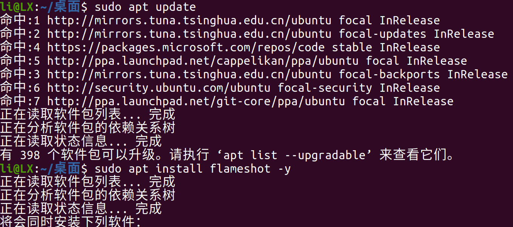
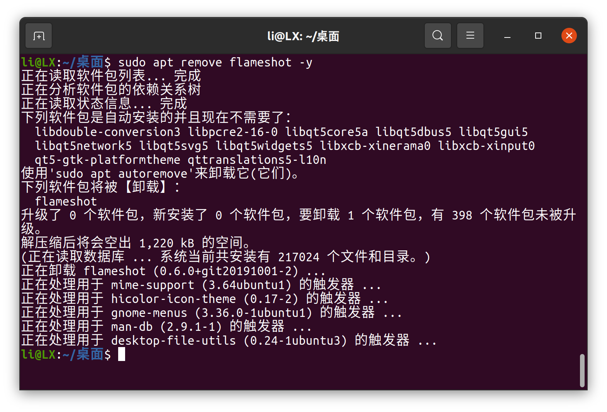

#### 5）其他

    find [路径] -name [文件名]：查找文件，例：find /home -name "*.txt"（在 home 目录找所有 .txt 文件）；
    grep [关键词] [文件]：搜索文件内容，例：grep "error" /var/log/syslog（查找日志中的错误信息）；
    man [命令]：查看命令帮助手册（按 q 退出），例：man ls；
    sudo [命令]：以管理员权限执行命令（需输入当前用户密码），例：sudo reboot（重启系统）。

---
### 2.Python与C++编程练习
#### 1）环境
##### python3与pip环境检查
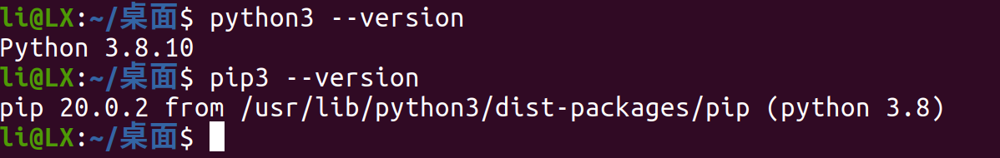
##### GCC/G++编译环境配置
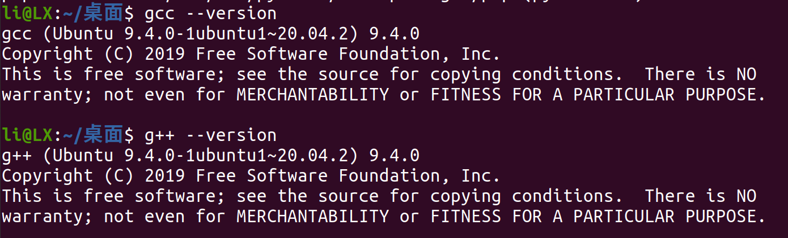
#### 2）Python Helloworld
创建python文件
```shell
gedit hello_world.py
```
用文本编辑器打开hello_world.py文件，编写代码
```shell
python3 hello_world.py
```
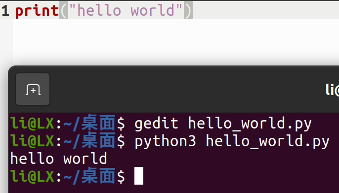

##### **其他方法**：终端直接输入
```shell
python3 -c 'print("Hello World!")'
```
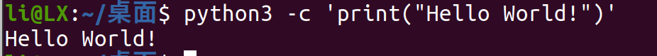

#### 3）C++数字求和
- **创建项目目录cppdemo**
```shell
mkdir ~/Projects/cppdemo && cd ~/Projects/cppdemo
vi sum.cpp
```

- **写入**：按i编辑，按ESC退出编辑
按shift+：，最下面出现：
按wq保存退出

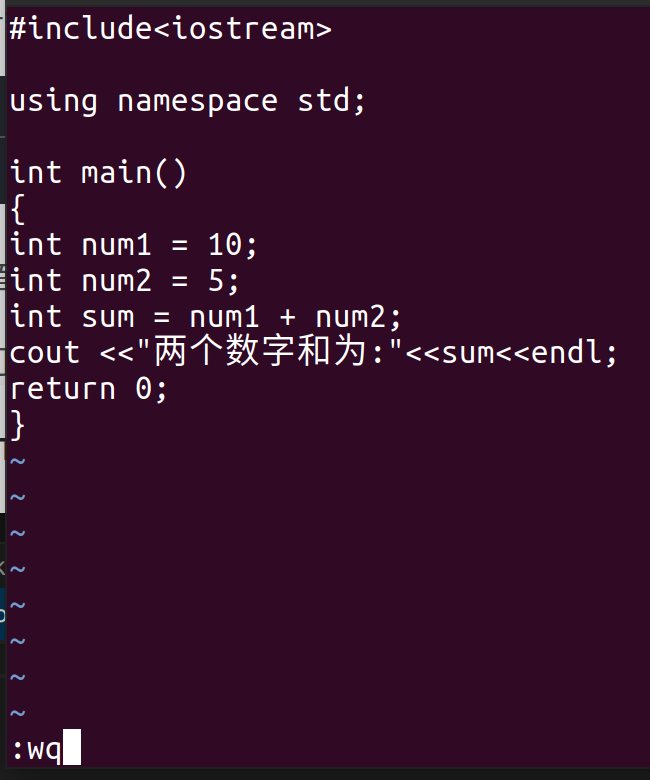
- **编译**：用g++编译器编译，生成可执行文件，执行可执行文件
objdump
- **运行**：
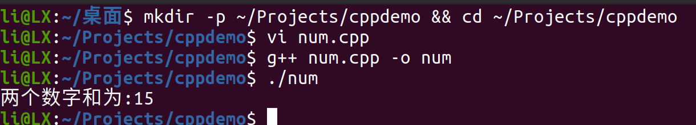
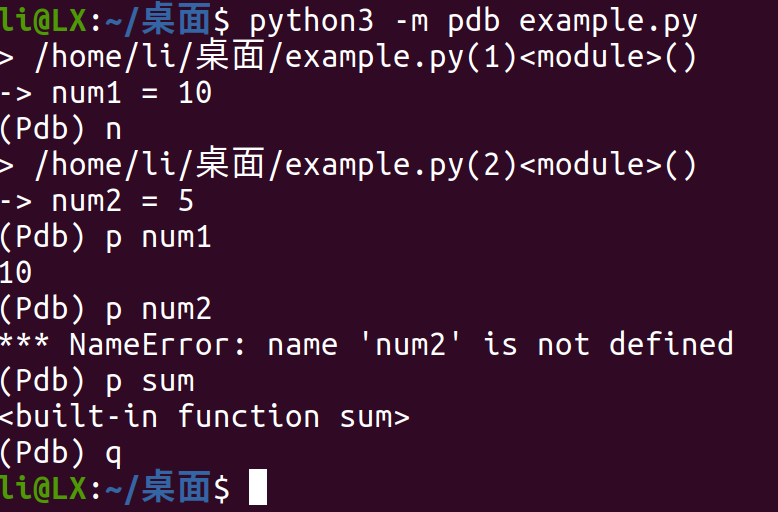

#### 4）VSCode调试环境准备
打开VSCode
```shell
code
```
确保插件已安装：
- C/C++
- Python
- CMake
- ROS
点击左侧“运行与调试” → 创建 launch.json → 选择 C++ 。
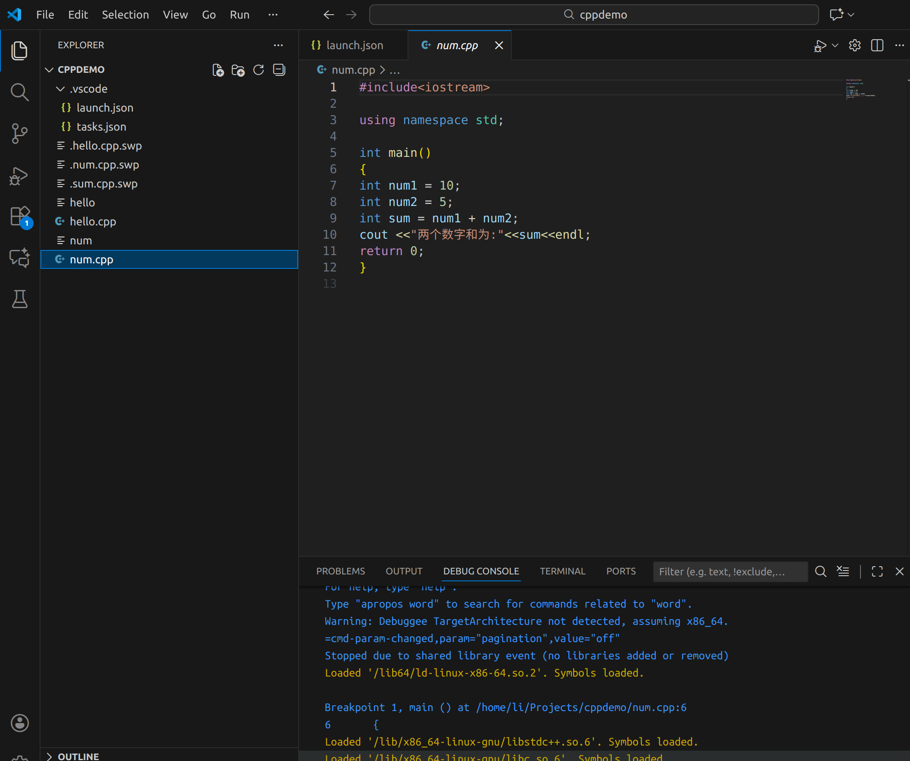
---

### 3.ROS1安装验证
#### 1）配置系统软件源
- 原来的源备份
```shell
sudo cp /etc/apt/sources.list /etc/apt/sources.list.backup
```
- 进入清华大学开源软件镜像站（这里我进入发现没有20.04的，所以我直接去问的豆包）
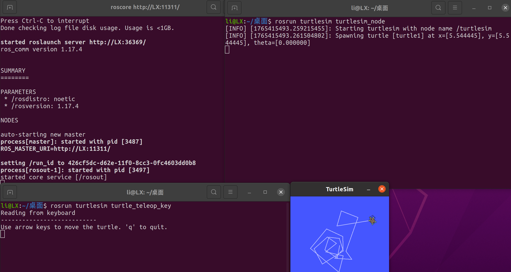

#### 2）rostopic控制
- 输入话题列表查看指令
```shell
rostopic list
```
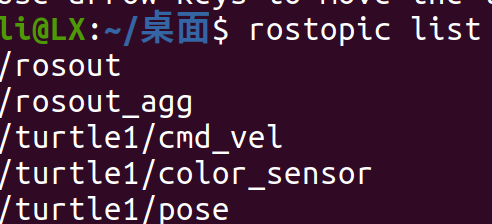
- 通过 `rostopic pub` 命令，给指定的话题发布消息（示例：以 1Hz 发布以让乌龟向前并转向）
```shell
rostopic pub -r 1 /turtle1/cmd_vel geometry_msgs/Twist "linear:
    x: 0.5
    y: 0.0
    z: 0.0
angular:
    x: 0.0
    y: 0.0
    z: 1.0"
```
#### 3）添加ROS密钥
```shell
sudo apt-key adv --keyserver 'hkp://keyserver.ubuntu.com:80' --recv-key C1CF6E31E6BADE8868B172B4F42ED6FBAB17C654
```
#### 4）安装ROS
```shell
sudo apt update
sudo apt-get install aptitude
sudo aptitude install ros-noetic-desktop-full
```
#### 5）设置环境变量
```shell
echo "source /opt/ros/noetic/setup.bash" >> ~/.bashrc
source ~/.bashrc
```
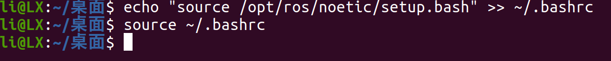

#### 6）初始化rosdep
1. 克隆rosdistro文件
```shell
cd /opt/ros/noetic/
sudo git clone https://github.com/ros/rosdistro.git
```


2. 修改文件1：20-default.list
```shell
cd /opt/ros/noetic/rosdistro/rosdep/sources.list.d/
sudo gedit 20-default.list
```
修改为如下内容
```
# os-specific listings first
yaml file:///opt/ros/noetic/rosdistro/rosdep/osx-homebrew.yaml osx

# generic
yaml file:///opt/ros/noetic/rosdistro/rosdep/base.yaml
yaml file:///opt/ros/noetic/rosdistro/rosdep/python.yaml
yaml file:///opt/ros/noetic/rosdistro/rosdep/ruby.yaml
gbpdistro file:///opt/ros/noetic/rosdistro/releases/fuerte.yaml fuerte

# newer distributions (Groovy, Hydro, ...) must not be listed anymore, they are being fetched from the rosdistro index.yaml instead
```


3. 修改文件2：gbpdistro_support.py
```shell
cd /usr/lib/python3/dist-packages/rosdep2/
sudo gedit gbpdistro_support.py
```
修改为如下内容：
```
FUERTE_GBPDISTRO_URL = 'file:///opt/ros/noetic/rosdistro/' \
    'releases/fuerte.yaml'
```


4. 修改文件3：rep3.py
```shell
cd /usr/lib/python3/dist-packages/rosdep2/
sudo gedit rep3.py
```
修改为如下内容:
```
REP3_TARGETS_URL = 'file:///opt/ros/noetic/rosdistro/releases/targets.yaml'
```


5. 修改文件4：_init_.py
```shell
cd /usr/lib/python3/dist-packages/rosdistro/
sudo gedit __init__.py
```
修改为如下内容:
```
DEFAULT_INDEX_URL = 'file:///opt/ros/noetic/rosdistro/index-v4.yaml'
```


6. 安装python-rosdep
```shell
sudo apt-get install python3-rosdep
```


7. 创建20-default.list文件
```shell
sudo mkdir -p /etc/ros/rosdep/sources.list.d 
cd /etc/ros/rosdep/sources.list.d
sudo gedit 20-default.list
```
修改为如下内容:
```
#os-specific listings first
yaml file:///opt/ros/noetic/rosdistro/rosdep/osx-homebrew.yaml osx
#generic
yaml file:///opt/ros/noetic/rosdistro/rosdep/base.yaml
yaml file:///opt/ros/noetic/rosdistro/rosdep/python.yaml
yaml file:///opt/ros/noetic/rosdistro/rosdep/ruby.yaml
gbpdistro file:///opt/ros/noetic/rosdistro/releases/fuerte.yaml fuerte
#newer distributions (Groovy, Hydro, ...) must not be listed anymore, they are being fetched from the rosdistro index.yaml instead
```

- 完成初始化rosdep
```shell
rosdep update
```

#### 7）安装rosinstall
```shell
sudo apt install python3-rosdep 
sudo apt install python3-rosinstall 
sudo apt install python3-rosinstall-generator 
sudo apt install python3-wstool 
sudo apt install build-essential
```

#### 8）运行ROS
```shell
roscore
```
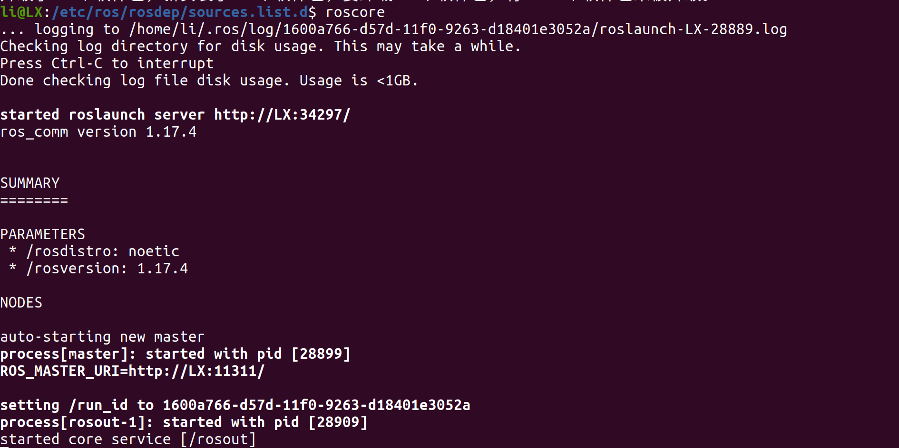

#### 9）自检
```shell
roswtf
```
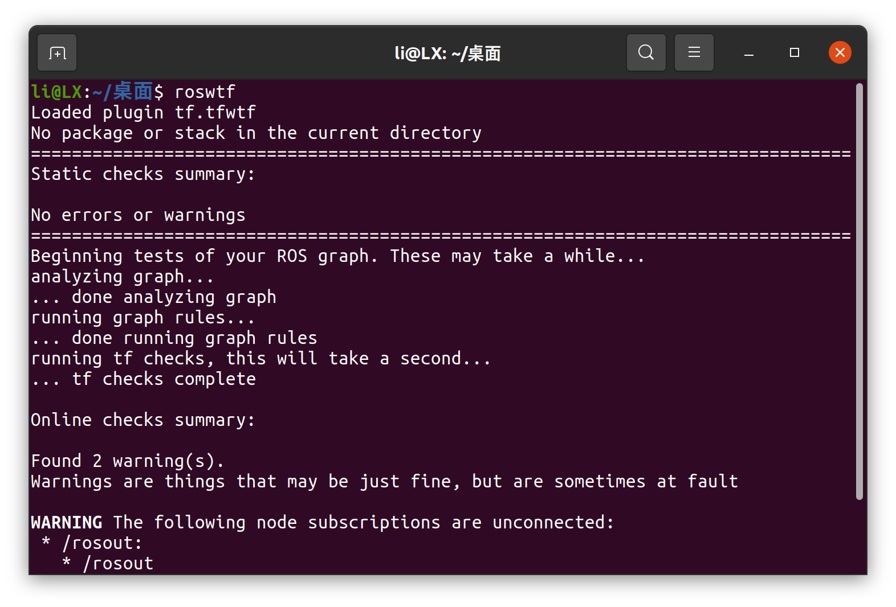

#### 10）ROS初次尝试
```shell
# 启动ROS Master
roscore

# 启动小海龟仿真器
rosrun turtlesim turtlesim_node

# 启动小海龟控制节点
rosrun turtlesim turtle_teleop_key
```
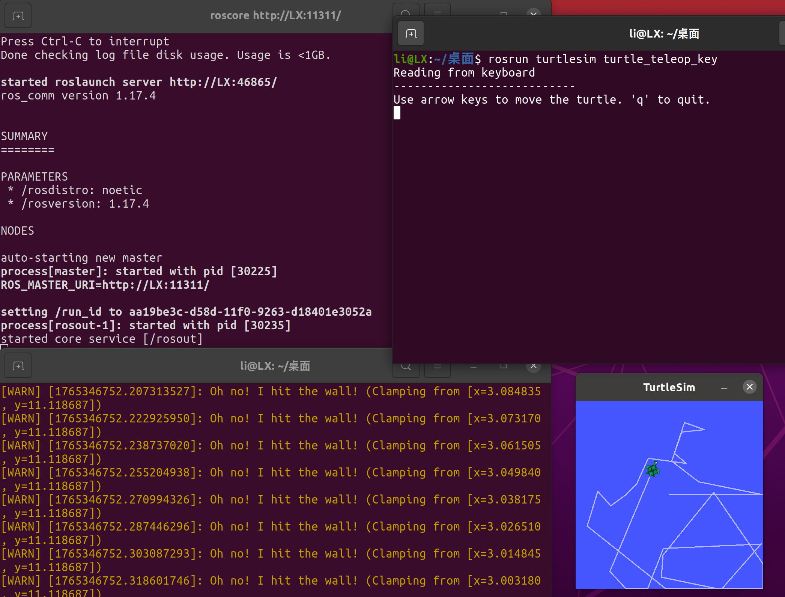

####  查看ROS环境变量
- 所有环境变量
```shell
env
```
```shell
echo $ROS_DISTRO
echo $ROS_PACKAGE_PATH
```


---

#### 4.CATKIN工作空间与功能包
##### 1）概念
###### 工作空间
在Catkin编译系统下，一个典型的工作空间一般包含四个目录空间：src、devel、build、install
- src: 代码空间(Source Space)，最常用、最重要的文件夹，用来存储所有ROS功能包(package)的源文件。
- build: 编译空间（Build Space），由catkin_make命令自动生成，用来存储工作空间编译过程中产生的缓存信息和中间文件。
- devel: 开发空间（Development Space），由catkin_make命令自动生成，用来放置编译生成的可执行文件。
- install: 安装空间（Install Space），不是必需的，很多工作空间没有该文件夹。编译成功后，可以使用make install命令将可执行文件安装到该空间中，运行该空间中的环境变量脚本，即可在终端中运行这些可执行文件。
###### 功能包
功能包(package)是ROS中的基本单元，包含ROS节点、库、配置文件等。
一个功能包的典型文件结构如下：

    config：功能包的配置文件，用户创建。
    include：需要用到的头文件。
    scripts：可以直接运行的Python脚本。
    src：需要编译的C++代码。
    launch：所有启动文件。
    msg：自定义的消息类型。
    srv：自定义的服务类型。
    action：自定义的动作指令。
    CMakeLists.txt：Catkin编译器编译功能包的规则。
##### 2）catkin_ws创建与catkin_make编译
###### 创建工作空间
```shell
mkdir -p ~/catkin_ws/src        #使用系统命令创建工作空间目录
cd ~/catkin_ws/src
catkin_init_workspace           # ROS的工作空间初始化命令
```
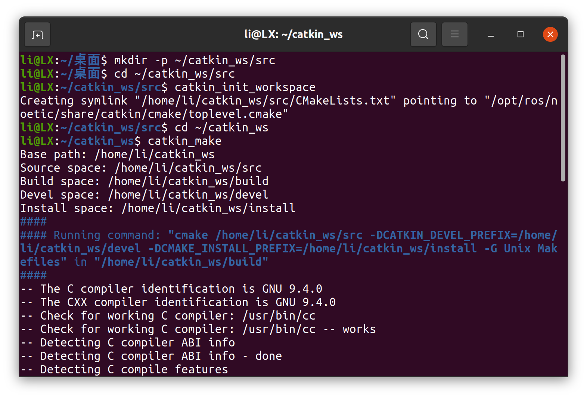
###### catkin_make 命令编译整个工作空间
```shell
cd ~/catkin_ws                  # 回到工作空间的根目录
catkin_make                     # 编译整个工作空间
```
```shell
source devel/setup.bash
echo $ROS_PACKAGE_PATH
```
##### 3）beginner_tutorials功能包
功能包创建：
```shell
cd ~/catkin_ws/src
#catkin_create_pkg创建功能包
catkin_create_pkg beginner_tutorials roscpp rospy std_msgs

#回到工作空间根目录，重新编译
cd ~/catkin_ws/
catkin_make
source devel/setup.bash
```
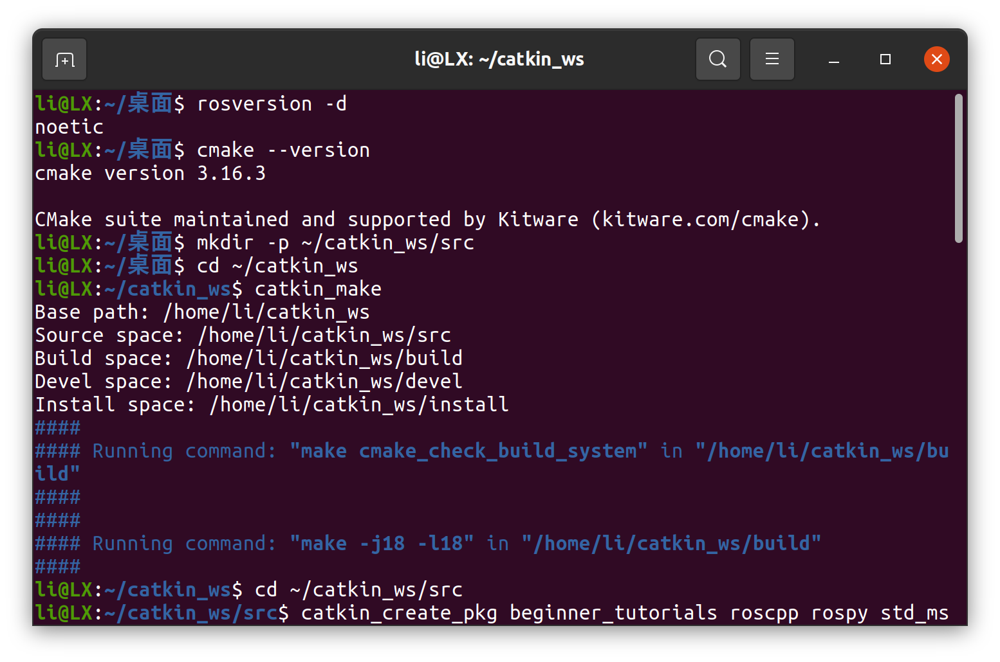
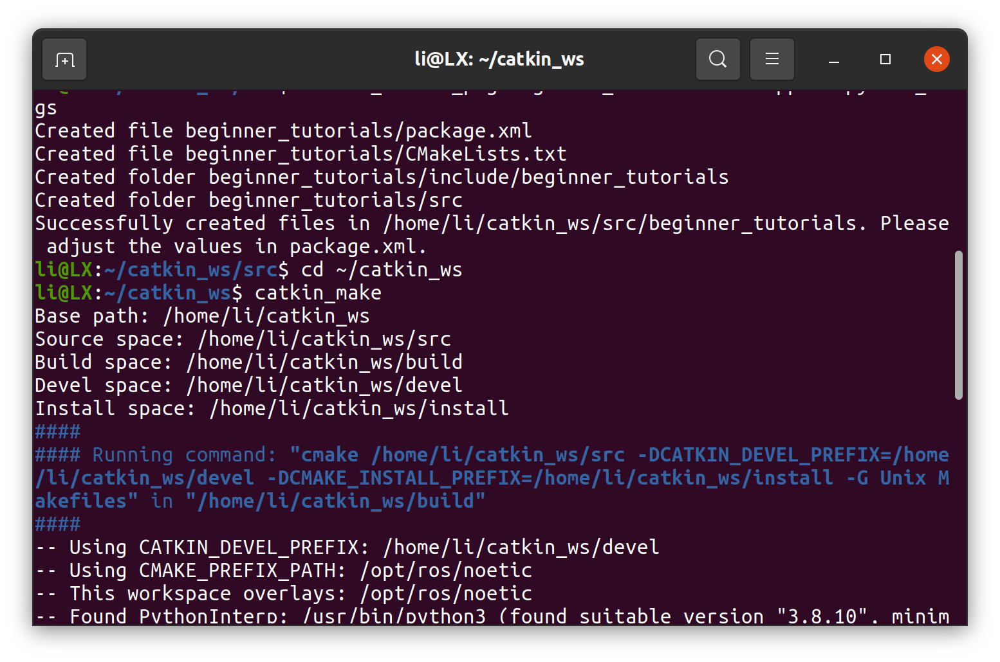
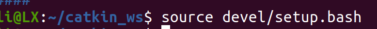
[遇见问题2依赖包不同](#问题依赖包不同)

##### 4）HelloWorld节点运行
- 编写Hello World节点代码
```shell
cd ~/catkin_ws/src/beginner_tutorials/src

touch hello_world.cpp
nano hello_world.cpp
```
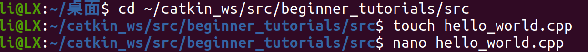
编辑
```C++
#include <ros/ros.h>
#include <std_msgs/String.h>
int main(int argc, char **argv){    // 初始化ROS节点
    ros::init(argc, argv, "hello_world_node");     // 创建ROS节点句柄
    ros::NodeHandle nh;     // 创建一个发布者，发布类型为String的主题
    ros::Publisher pub = nh.advertise<std_msgs::String>("hello_world_topic", 10);     // 设置循环的频率
    ros::Rate rate(1); // 发布频率为1Hz

    while (ros::ok())    {        // 创建一个String类型的消息
        std_msgs::String msg;
        msg.data = "Hello World";         // 发布消息
        pub.publish(msg);         // 输出消息到控制台
        ROS_INFO("Published: %s", msg.data.c_str());         // 按照频率休眠
        rate.sleep();
    }
    return 0;
}
```
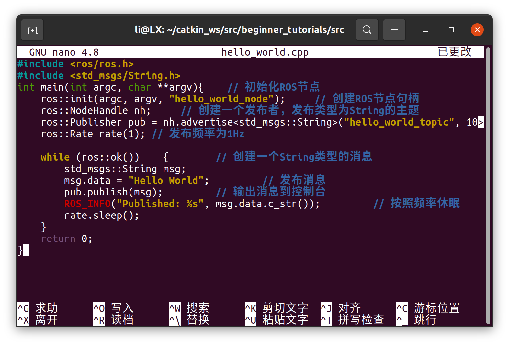
- 修改功能包的编译配置
打开功能包的CMakeLists.txt,添加
```
#找到依赖包
find_package(catkin REQUIRED COMPONENTS
    roscpp
    rospy
    std_msgs
)
#声明可执行文件
add_executable(hello_world_node src/hello_world.cpp)
#链接依赖库
target_link_libraries(hello_world_node
  ${catkin_LIBRARIES}
)
```
- 编译并运行节点
```shell
cd ~/catkin_ws/
catkin_make

roscore
```
```source ~/catkin_ws/devel/setup.bash
rosrun beginner_tutorials hello_world_node
```
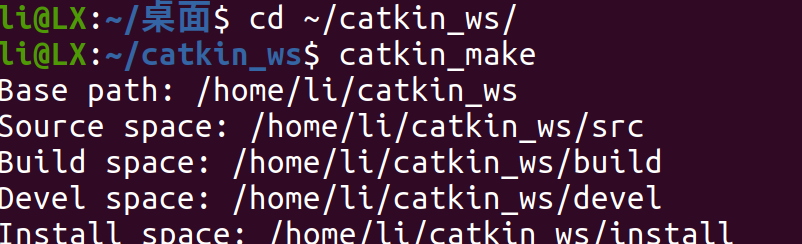
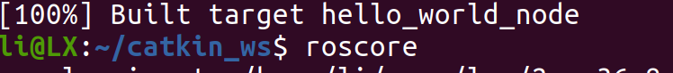
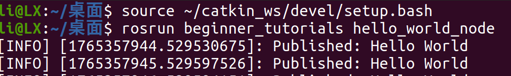
---


### 5.Turtlesim小乌龟基础
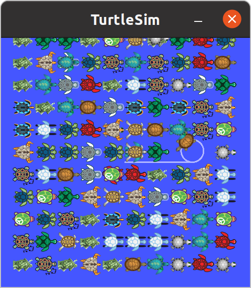
#### 1）键盘控制
打开ROS服务
```shell
roscore 
```
```shell
rosrun turtlesim turtlesim_node 
```
这里通过键盘控制小乌龟，这个终端窗口必须**置顶**才能键盘控制
```shell
rosrun turtlesim turtle_teleop_key 
```


#### 2）rostopic控制
- 输入话题列表查看指令
```shell
rostopic list
```

- 通过rostopic pub命令，给指定的话题发布消息 
```shell
ostopic pub /turtle1/cmd_vel geometry_msgs/Twist “linear:
x: 0.5
y: 0.0
z: 0.0
angular:
x: 0.0
y: 0.0
z: 1.0” 
```
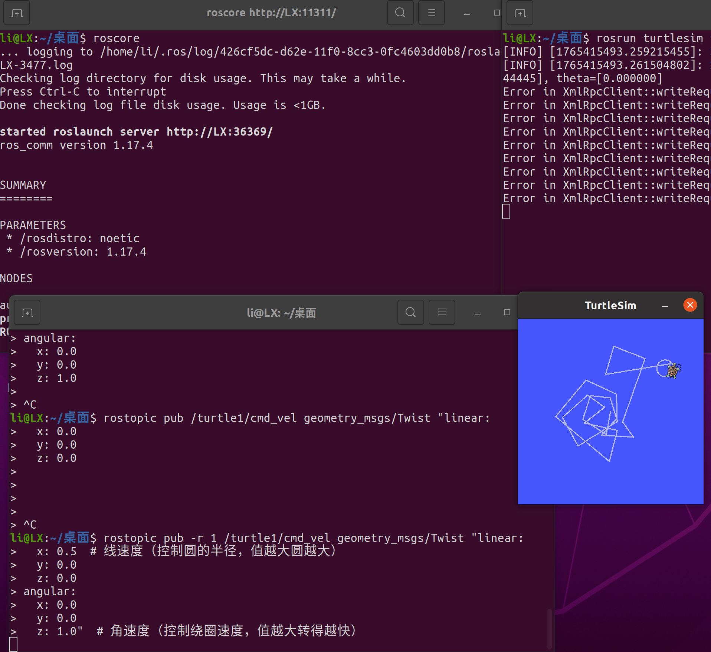
我这里让小乌龟画圈


#### 3）程序控制小乌龟
- 创建功能包
```shell
cd ~/catkin_ws/src
catkin_create_pkg turtle_control rospy geometry_msgs
cd ~/catkin_ws && catkin_make
```
- 在~/catkin_ws/src/turtle_control/scripts/下新建draw_circle.py：
```shell
cd ~/catkin_ws/src/turtle_control/scripts
gedit draw_circle.py
```
```python
#!/usr/bin/env python3
import rospy
from geometry_msgs.msg import Twist

def draw_circle():
    rospy.init_node('turtle_draw_circle', anonymous=True)
    pub = rospy.Publisher('/turtle1/cmd_vel', Twist, queue_size=10)
    rate = rospy.Rate(10)  # 10Hz

    vel_msg = Twist()
    # 线速度（x方向）
    vel_msg.linear.x = 0.5
    vel_msg.linear.y = 0.0
    vel_msg.linear.z = 0.0
    # 角速度（z方向）
    vel_msg.angular.x = 0.0
    vel_msg.angular.y = 0.0
    vel_msg.angular.z = 1.0

    while not rospy.is_shutdown():
        pub.publish(vel_msg)
        rate.sleep()

if __name__ == '__main__':
    try:
        draw_circle()
    except rospy.ROSInterruptException:
        pass
```
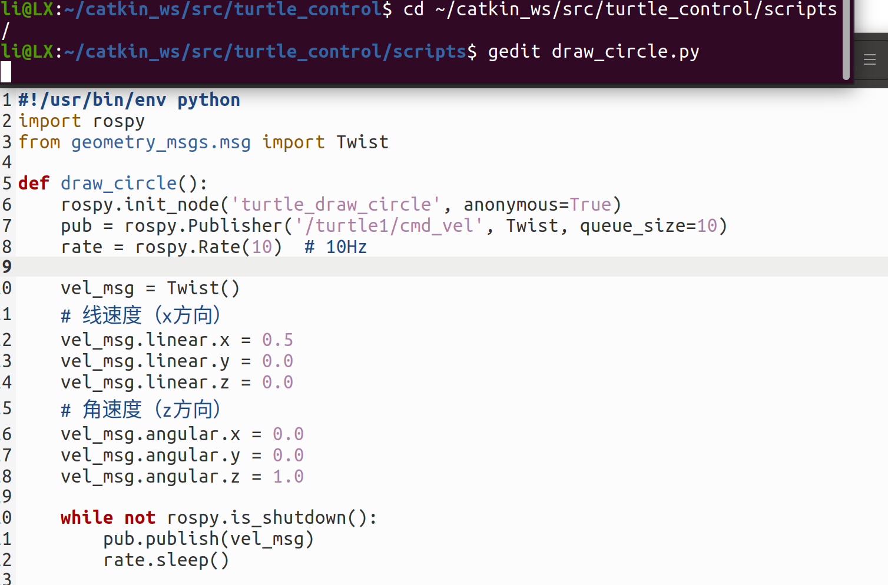
这里图片里有一个小错误**python3**
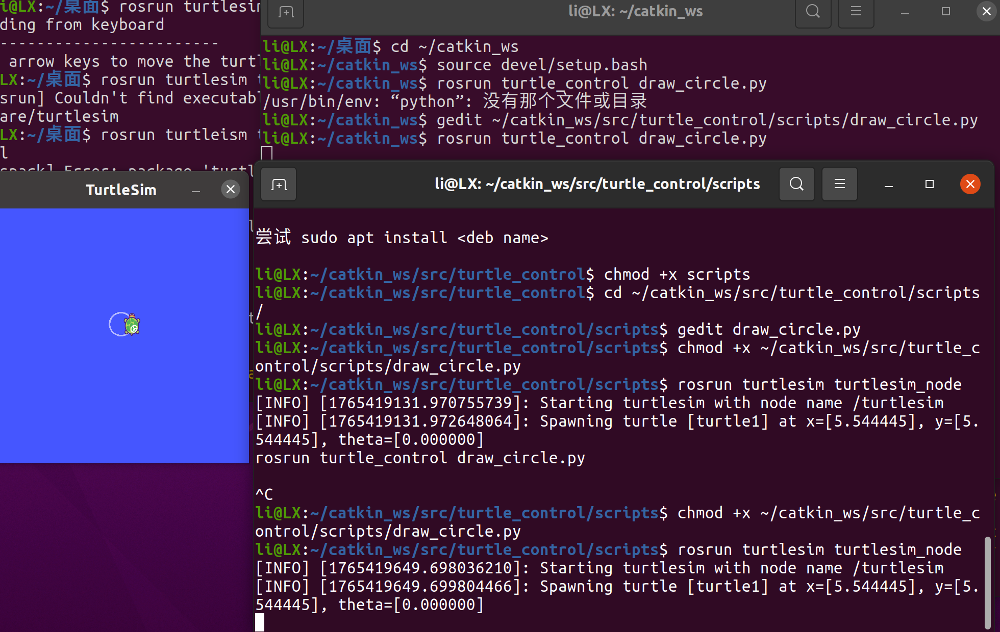
- 运行
```shell
chmod +x ~/catkin_ws/src/turtle_control/scripts/draw_circle.py
rosrun turtlesim turtlesim_node
rosrun turtle_control draw_circle.py
```

---
### 6.多乌龟launch——rqt_graph
- **创建**launch文件 (同时打开多个节点)
在~/catkin_ws/src/turtle_control/launch/下新建multi_turtle.launch：
```xml
<launch>
    <!-- 启动turtlesim节点 -->
    <node pkg="turtlesim" type="turtlesim_node" name="turtlesim_node"/>
    
    <!-- 生成第二只乌龟（turtle2） -->
    <node pkg="rosservice" type="rosservice" name="spawn_turtle2" args="call --wait /spawn 2 2 0 'turtle2'"/>
</launch>
```
- **运行**launch文件
```shell
roslaunch turtle_control multi_turtle.launch
```
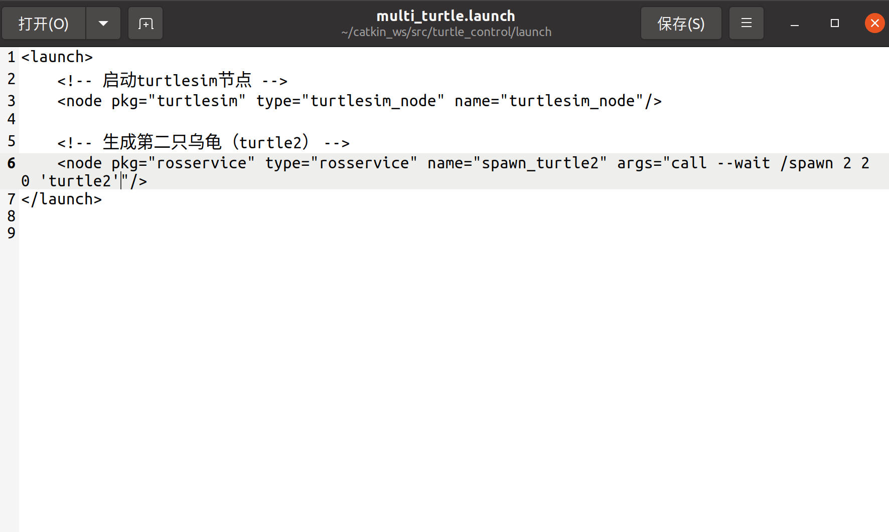
- **调用**服务 /spawn 创建第二只乌龟 turtle2
```shell
rosservice call /spawn 5.0 5.0 0.0 "turtle2"
```
- 分别**控制**两个乌龟
```shell
# 控制turtle1（前进）
rostopic pub -r 1 /turtle1/cmd_vel geometry_msgs/Twist "linear:
  x: 0.5
  y: 0.0
  z: 0.0
angular:
  x: 0.0
  y: 0.0
  z: 0.0"
```
```shell
# 新终端控制turtle2（转圈）
rostopic pub -r 1 /turtle2/cmd_vel geometry_msgs/Twist "linear:
  x: 0.0
  y: 0.0
  z: 0.0
angular:
  x: 0.0
  y: 0.0
  z: 1.0"
```
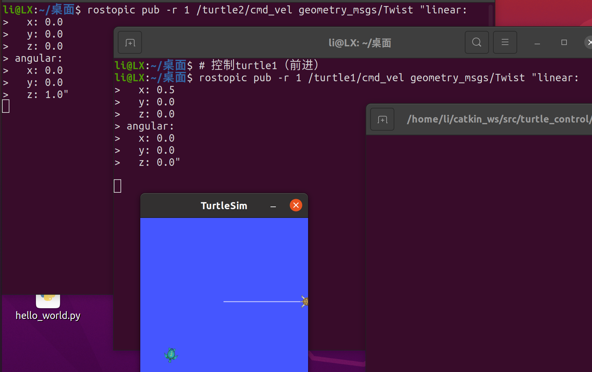

- rqt工具使用
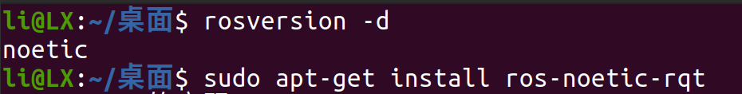
```shell
# 查看通信图
rqt_graph
```
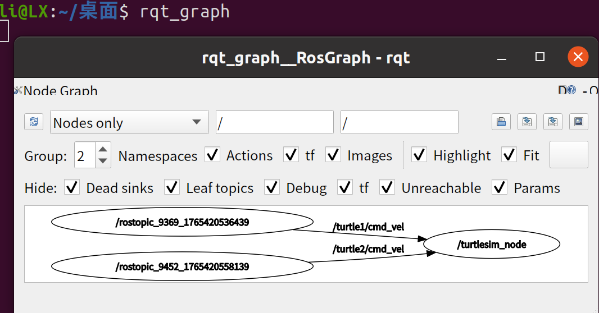
```shell
# 绘制速度图
rqt_plot /turtle1/cmd_vel/linear/x /turtle2/cmd_vel/angular/z
```
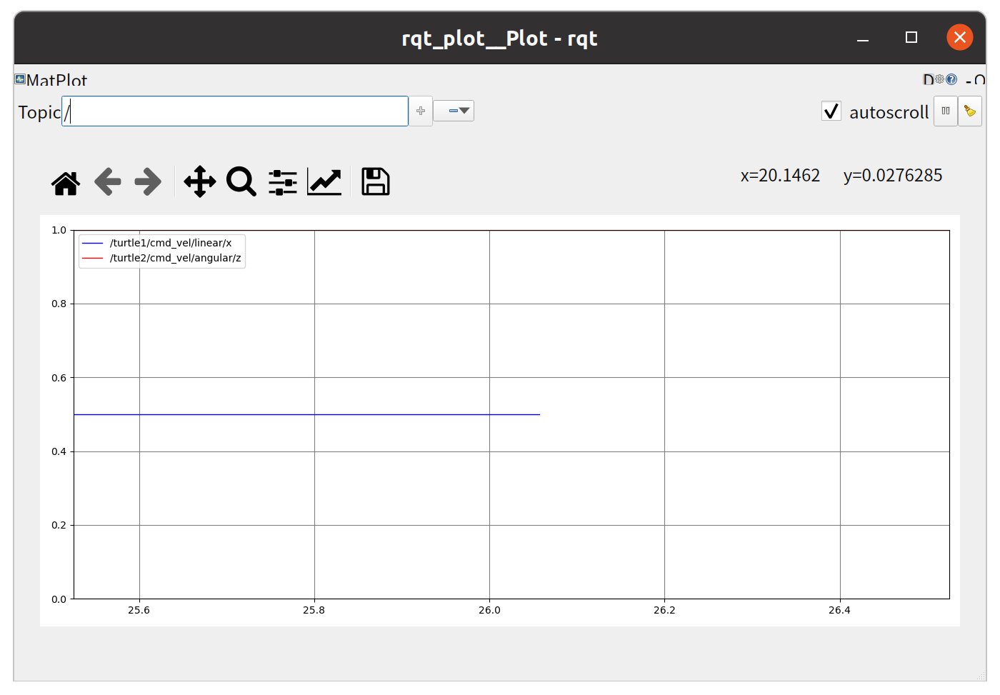

---
## 三. 遇到问题与解决方法
#### 问题：删除文件显示没有找到那个文件或目录
    - 可能原因：当前不在文件所在的目录里
    - 解决方法：cd移动目录
        ```shell
        rm week2.txt
        ```
**注意这里删除要在week2目录下面删除，不然就无法删除：没有找到那个文件或目录**
    我这里先把原来在桌面生成的文件移到下载里面，然后直接用rm还是在桌面目录里面，但是week2文件已经移动到下载里面，所以删除时没有找到这里week2的文件
**补充**在第二周整体过程中有好多次需要更换目录的过程，如果在错误的目录中有些操作就会报错。

#### 问题：依赖包不同
    我的依赖包由roscpp+rospy+std_msgs组成 ----功能模块支持：基础消息通信能力
    文件中的依赖由roscpp+std_msgs+geometry_msgs组成 ----功能模块支持：基础消息+几何数据（位姿，速度等）处
    - 解决反法：手动添加geometry_msgs
    
    
    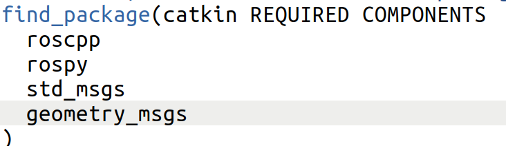

#### 问题：spawn /spawn 服务调用失败，不能创建多乌龟。
    - 可能原因：`turtlesim_node` 未运行或服务名/参数错误。
    - 解决方法：先启动 `turtlesim_node`，然后在另一终端执行：
        ```bash
        rosservice call /spawn 2 2 0 turtle2
        ```
        或在 launch 文件中使用 `<node pkg="rosservice" type="rosservice" name="spawn_turtle2" args="call --wait /spawn 2 2 0 'turtle2'"/>` 的方式确保在正确顺序调用。

---

## 四. 总结与心得
- **实验概述**: 本周实验涵盖 Linux 常用命令与系统管理、Python 与 C++ 基础编程、ROS1（Noetic）的安装与验证、Catkin 工作空间和功能包管理，以及基于 turtlesim 的机器人模拟与控制（包含单/多乌龟操控、launch 启动与 rqt 系列工具的可视化）。通过从环境搭建到节点编写与调试的完整实践，掌握了 ROS 开发的基本流程。

- **主要收获**:
    - 系统与命令行能力: 熟练使用 ls/cd/cp/mv/rm、权限管理 (chmod/chown)、进程查看与控制 (ps/kill/top) 及软件包管理（apt），提升了在 Linux 下进行开发与调试的效率。
    - 编程与构建流程: 通过 Python 脚本与 C++ 小项目，复现了从代码编写、编译到运行的完整流程，理解了基本调试手段与常见错误排查方法。
    - ROS 环境与包管理: 学会了配置 APT 源、添加 ROS 软件源与密钥、安装 ros-noetic、配置 ~/.bashrc 环境变量并初始化 rosdep，对 ROS 依赖管理与安装流程有了直观理解。
    - ROS 开发與調試工具: 能够创建 Catkin 工作空间、编写功能包、编写并运行发布/订阅节点（例如 Hello World、控制 turtlesim 的脚本），并使用 rqt_graph、rqt_plot 等工具可视化与诊断节点间通信.
