# Week3 实验报告

## 摘要
实验内容涵盖 Publisher 与 Subscriber 通信模式实现、基于 launch 文件的多 turtlesim 节点管理与跟随控制、TF 树查看与调试、RViz 显示 TF 变换、Gazebo 仿真环境体验与模型加载，以及 ROS Bonus 任务（自定义消息类型、TurtleBot3 在 Gazebo 中的仿真、rosbag 数据录制与播放、RViz 显示激光或点云数据）的实现，还包括实验中遇到的问题及解决方法、总结与心得。

## 环境
实验基于ROS Noetic版本，运行在 Linux 系统。涉及的主要工具和包包括：

    基础 ROS 工具：roscore、rosrun、roslaunch、rostopic、rosmsg、rosbag等
    功能包：std_msgs、roscpp、rospy、geometry_msgs、turtlesim、tf、gazebo_ros、custom_msg_pkg（自定义）、turtle_follower（自定义）、turtlebot3相关包（turtlebot3_gazebo、turtlebot3_teleop等）
    可视化工具：rqt_graph、rqt_tf_tree、RViz、Gazebo


## **一.实验任务**
### 1.Publisher + Subscriber
### 2.launch 多turtlesim + namespace + 跟随控制
### 3. 查看 TF 树与调试
### 4.使用 RViz 显示 TF
### 5. Gazebo 体验与模型加载
#### 6.ROS Bonus 任务实验报告
---
## **二.实现过程**
### 一.Publisher + Subscriber
#### 1.1 环境准备：创建功能包
##### 创建功能包（依赖std_msgs和roscpp）
```shell
cd src
catkin_create_pkg my_pub_sub std_msgs roscpp
cd ~/catkin_ws/
catkin_make
source devel/setup.bash
```

#### 1.2 编写 Publisher 节点
在my_pub_sub/src目录下创建publisher_node.cpp，代码功能为**发布随机字符串到自定义话题random_strings**：
```cpp
#include "ros/ros.h"
#include "std_msgs/String.h"
#include <sstream>
#include <cstdlib>
#include <ctime>

int main(int argc, char **argv)
{
    ros::init(argc, argv, "random_string_publisher");
    ros::NodeHandle n;
    ros::Publisher chatter_pub = n.advertise<std_msgs::String>("random_strings", 10);
    ros::Rate loop_rate(1); // 1Hz发布频率
    std::srand(std::time(nullptr));

    int count = 0;
    while (ros::ok())
    {
        std_msgs::String msg;
        std::stringstream ss;
        
        // 生成5-10位随机小写字母字符串
        std::string random_str;
        int length = 5 + std::rand() % 6;
        for(int i = 0; i < length; i++){
            char c = 'a' + std::rand() % 26;
            random_str += c;
        }

        ss << "发布的随机字符串 #" << count << ": " << random_str;
        msg.data = ss.str();
        ROS_INFO("%s", msg.data.c_str());
        chatter_pub.publish(msg);

        ros::spinOnce();
        loop_rate.sleep();
        ++count;
    }
    return 0;
}
```
#### 1.3 编写 Subscriber 节点
在my_pub_sub/src目录下创建subscriber_node.cpp，代码功能为**订阅random_strings话题并打印消息**：
```cpp
#include "ros/ros.h"
#include "std_msgs/String.h"

// 消息回调函数
void chatterCallback(const std_msgs::String::ConstPtr& msg)
{
    // 注意：msg是智能指针，需用->访问成员（此处为真实踩坑点）
    ROS_INFO("接收到的消息: %s", msg->data.c_str());
}

int main(int argc, char **argv)
{
    ros::init(argc, argv, "string_subscriber");
    ros::NodeHandle n;
    ros::Subscriber sub = n.subscribe("random_strings", 10, chatterCallback);
    ros::spin();
    return 0;
}
```
#### 1.4 配置编译文件（CMakeLists.txt）
编辑my_pub_sub/CMakeLists.txt，在文件末尾添加：
```cmake
add_executable(publisher_node src/publisher_node.cpp)
target_link_libraries(publisher_node ${catkin_LIBRARIES})
add_dependencies(publisher_node ${${PROJECT_NAME}_EXPORTED_TARGETS} ${catkin_EXPORTED_TARGETS})

add_executable(subscriber_node src/subscriber_node.cpp)
target_link_libraries(subscriber_node ${catkin_LIBRARIES})
add_dependencies(subscriber_node ${${PROJECT_NAME}_EXPORTED_TARGETS} ${catkin_EXPORTED_TARGETS})
```
#### 1.5 编译与运行
1.编译工作空间：
```shell
cd ~/catkin_ws/
catkin_make
source devel/setup.bash
```
2.启动节点（打开多个终端）：
- 终端 1：启动 ROS 核心
```shell
roscore
```
- 终端 2：启动发布者节点
```shell
rosrun my_pub_sub publisher_node
```
- 终端 3：启动订阅者节点
```shell
rosrun my_pub_sub subscriber_node
```
[遇到问题1：系统找不到名为subscriber_node的可执行文件](#1系统找不到名为subscriber_node的可执行文件)
[遇到问题2：编译订阅者节点提示msg.data语法错误]
- 终端 4：用rostopic echo交叉验证
```shell
rostopic echo /random_strings
```
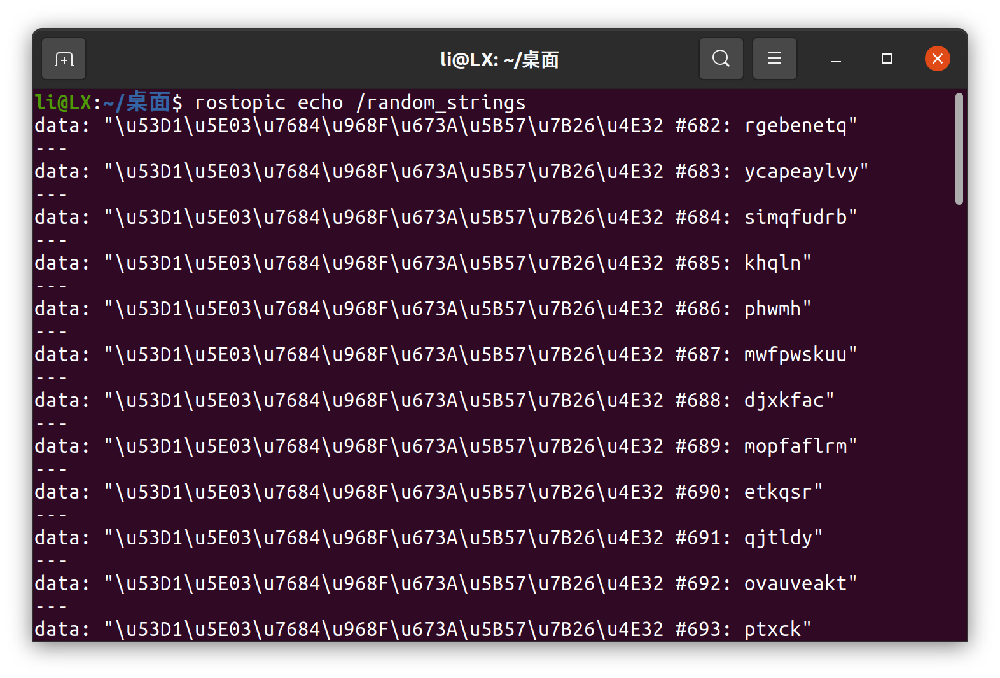
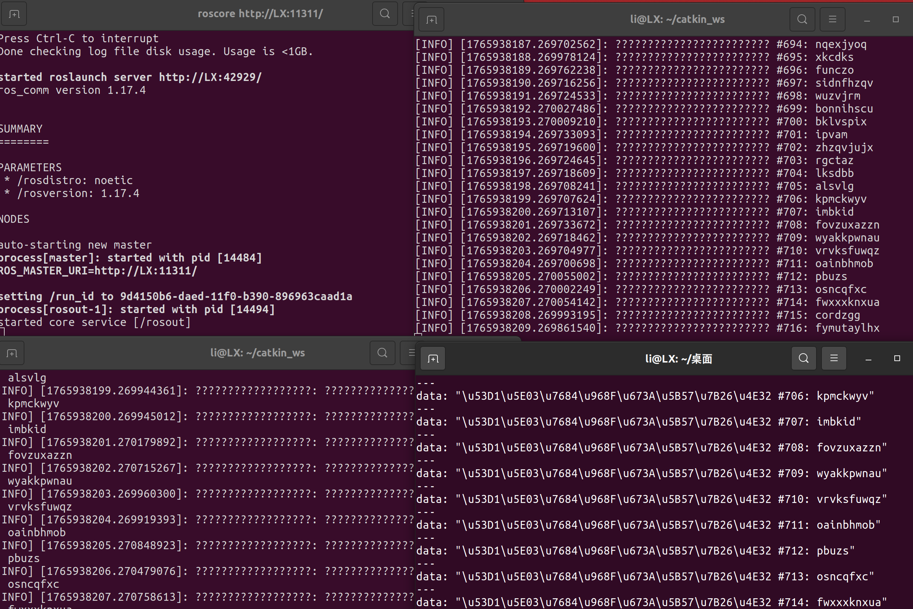

### 二.launch 多turtlesim + namespace + 跟随控制
#### 2.1 工作空间与功能包准备
创建功能包：
```shell
cd ~/catkin_ws/src
catkin_create_pkg turtle_follower roscpp rospy std_msgs geometry_msgs turtlesim
```
编译并设置环境变量
```shell
cd ~/catkin_ws
catkin_make
source devel/setup.bash
```
#### 2.2 编写 Launch 文件
在catkin_ws/src/turtle_follower/launch目录下创建follower.launch，实现两只 turtlesim 的启动 + 命名空间隔离 + 键盘控制节点启动：
```xml
<launch>
  <!-- 启动第一只乌龟，命名空间为turtle1，节点名为turtlesim_node1 -->
  <node pkg="turtlesim" type="turtlesim_node" name="turtlesim_node1" namespace="turtle1">
    <param name="turtle_name" value="turtle1" />
    <param name="x" value="2.0" />
    <param name="y" value="2.0" />
  </node>
  
  <!-- 启动第二只乌龟，命名空间为turtle2，节点名为turtlesim_node2 -->
  <node pkg="turtlesim" type="turtlesim_node" name="turtlesim_node2" namespace="turtle2">
    <param name="turtle_name" value="turtle2" />
    <param name="x" value="8.0" />
    <param name="y" value="8.0" />
  </node>
  
  <!-- 启动键盘控制节点，控制turtle1 -->
  <node pkg="turtlesim" type="turtle_teleop_key" name="teleop_key" output="screen">
    <remap from="cmd_vel" to="/turtle1/turtle1/cmd_vel" />
  </node>
  
  <!-- 启动跟随节点 -->
  <node pkg="turtle_follower" type="follower_node.py" name="follower_node" output="screen" />
</launch>
```
#### 2.3 编写跟随控制程序
在catkin_ws/src/turtle_follower/scripts目录下创建follower.py，实现turtle2 对 turtle1 的简易 P 控制跟随：
```python
#!/usr/bin/env python3
import rospy
import math
from turtlesim.msg import Pose
from geometry_msgs.msg import Twist

class TurtleFollower:
    def __init__(self):
        rospy.init_node("turtle_follower")
        # 存储两只乌龟的位姿
        self.t1_pose = Pose()
        self.t2_pose = Pose()

        # 订阅turtle1的位姿（命名空间/turtle1下）
        rospy.Subscriber("/turtle1/turtle1/pose", Pose, self.update_t1_pose)
        # 订阅turtle2的位姿（命名空间/turtle2下）
        rospy.Subscriber("/turtle2/turtle2/pose", Pose, self.update_t2_pose)
        # 发布turtle2的速度指令（命名空间/turtle2下）
        self.vel_pub = rospy.Publisher("/turtle2/turtle2/cmd_vel", Twist, queue_size=10)

        # P控制参数
        self.Ka = 4.0  # 角度比例系数
        self.Kv = 0.5  # 线速度比例系数
        self.rate = rospy.Rate(10)  # 控制频率10Hz

    def update_t1_pose(self, data):
        self.t1_pose = data
    def update_t2_pose(self, data):
        self.t2_pose = data

    def follow(self):
        vel = Twist()
        # 1. 计算位置差Δx、Δy
        dx = self.t1_pose.x - self.t2_pose.x
        dy = self.t1_pose.y - self.t2_pose.y
        # 2. 计算目标朝向角
        target_theta = math.atan2(dy, dx)
        # 3. 计算角速度（角度误差控制）
        theta_err = target_theta - self.t2_pose.theta
        theta_err = (theta_err + math.pi) % (2*math.pi) - math.pi  # 处理角度环绕
        vel.angular.z = self.Ka * theta_err
        # 4. 计算线速度（距离误差控制）
        dist = math.sqrt(dx**2 + dy**2)
        vel.linear.x = self.Kv * dist
        # 发布速度
        self.vel_pub.publish(vel)
        self.rate.sleep()

if __name__ == "__main__":
    try:
        follower = TurtleFollower()
        while not rospy.is_shutdown():
            follower.follow()
    except rospy.ROSInterruptException:
        pass
```
给脚本添加可执行权限：
```shell
chmod +x ~/catkin_ws/src/turtle_follower/scripts/follower_code.py
```
#### 2.4 运行与验证
1. 编译功能包：
```shell
cd ~/catkin_ws
catkin_make
# 刷新环境变量
source devel/setup.bash
```
2. 启动 Launch 文件：
```shell
roslaunch turtle_follower turtle_follower.launch
```
[遇到问题3：启动 Launch 时提示 “multiple nodes named [/turtlesim_node]”](#3启动-launch-时提示-multiple-nodes-named-turtlesim_node)

3. 控制与观察：

    在启动 Launch 的终端中，用方向键控制 turtle1 移动，观察 turtle2 是否跟随；
    打开新终端，运行rqt_graph查看通信关系。
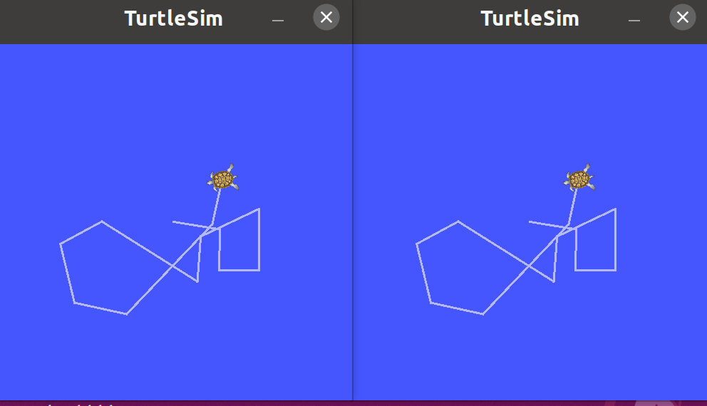
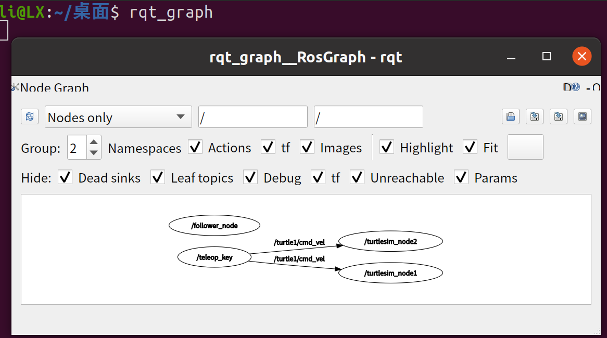

#### 2.6 跟随策略说明
采用简易 P 控制策略：通过计算 turtle1 与 turtle2 的位置差得到线速度（与距离成正比），计算朝向角误差得到角速度（与角度差成正比），从而实现 turtle2 对 turtle1 的跟随。

### 三. 查看 TF 树与调试
#### 3.1 启动包含 TF 广播的 ROS 系统
通过launch文件一键启动单窗口双乌龟 + TF 广播的完整系统：
```shell
# 进入工作空间
cd ~/catkin_ws/
# 重新编译（确保turtle_follower功能包被编译）
catkin_make
# 加载环境变量（必须执行，否则ROS找不到功能包）
source devel/setup.bash


# 启动launch文件（一键启动双乌龟、跟随控制、TF广播）
roslaunch turtle_follower turtle_follower.launch
```
效果：弹出 1 个 turtlesim 窗口，窗口内存在turtle1和turtle2，turtle2可跟随turtle1移动；后台持续广播world→turtle1_frame、world→turtle2_frame的 TF 变换。

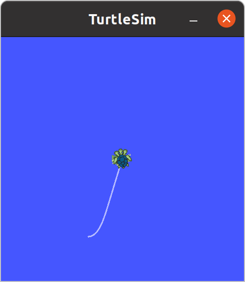(这里还有一只龟压在上面那只下面)
#### 3.2 命令行生成 TF 树文件（frames.pdf）
保持步骤 1 的终端运行，打开新终端，执行 TF 工具生成静态 TF 树文件：
```shell
# 生成TF树的PDF文件
rosrun tf view_frames
```
效果：终端提示Output written to frames.pdf，当前终端工作目录下生成frames.pdf（包含 TF 树的结构关系）。
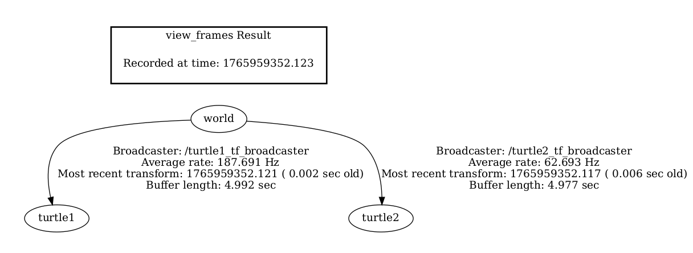
#### 3.3 实时可视化 TF 树（rqt_tf_tree）
保持系统运行，打开新终端，启动实时 TF 树可视化工具：
```shell
rqt_tf_tree
```
效果：工具窗口显示实时 TF 树结构（world为父坐标系，连接turtle1_frame和turtle2_frame）；移动turtle1时，可查看 TF 变换的实时数据。

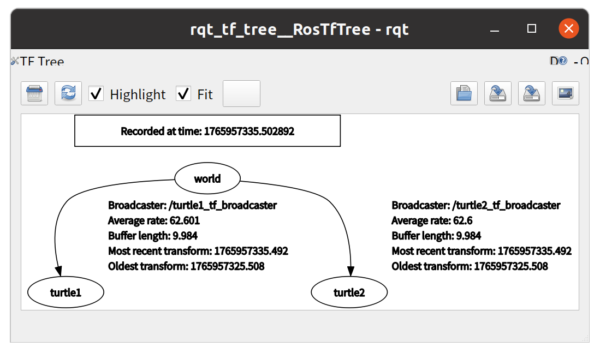
#### 3.4 TF 的核心作用
TF 是 ROS 中描述多坐标系相对位置 / 姿态关系的工具，机器人需要它的原因是：统一坐标系统和实现组件协同。

### 四.使用 RViz 显示 TF
#### 4.1 启动包含 TF 变换的 ROS 系统
1. 启动 ROS 核心（终端 1）：
```shell
roscore
```
2. 启动 turtlesim 节点（终端 2）：
```shell
cd ~/catkin_ws
source devel/setup.bash
rosrun turtlesim turtlesim_node
```
此时弹出 turtlesim 窗口，默认生成turtle1，自动广播world→turtle1的 TF 变换
3. 生成 turtle2 并广播其 TF（终端 3）：
```shell
# 生成turtle2
rosservice call /spawn 2 2 0.0 "turtle2"
# 广播world→turtle2的TF
rosrun tf static_transform_publisher 2 2 0 0 0 0 /world /turtle2 100
```
执行后 turtlesim 窗口出现turtle2，终端 3 持续广播 TF（无提示但可通过tf_echo验证）。
4. 验证 TF 变换（终端 4）：
```shell
rosrun tf tf_echo /world /turtle1
rosrun tf tf_echo /world /turtle2
```
输出平移、旋转参数，说明 TF 广播正常。
#### 4.2 RViz 配置与 TF 显示
1. 启动 RViz（终端 5）：
```shell
cd ~/catkin_ws
source devel/setup.bash
rviz
```
2. 基础配置：

    设置左上角Fixed Frame为world；
    点击Add→选择TF插件，勾选Show Axes/Show Names/Show Arrows；
    展开Frames列表，勾选world/turtle1/turtle2。
3. 添加 Axes 插件

    点击Add→选择Axes，配置Reference Frame为turtle1，设置Length=0.8、Radius=0.05；
    重复添加 Axes 插件，绑定turtle2。
4. 切换 Fixed Frame：
将Fixed Frame从world切换为turtle1，观察到视图参考系变为turtle1，world/turtle2显示相对位置。

[遇到问题4：RViz 中无turtle1坐标系](#4rviz-中无turtle1坐标系)

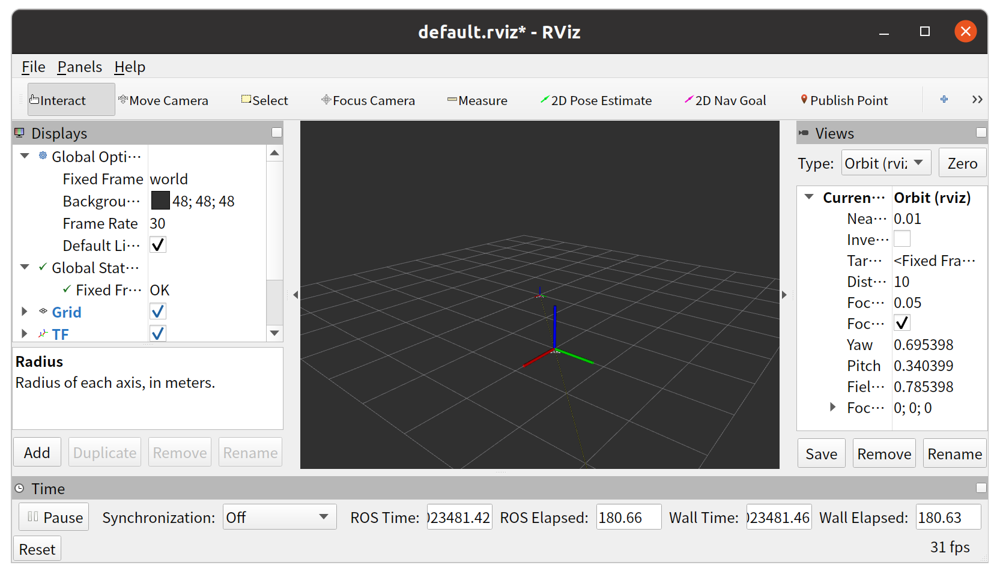
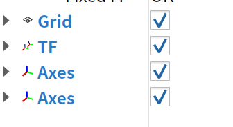
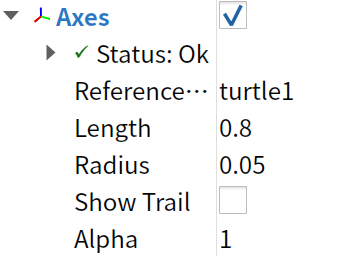
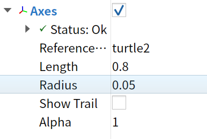
#### 4.3 Fixed Frame 概念说明：
Fixed Frame 是 RViz 3D 可视化视图的基准参考坐标系，所有 TF 坐标系都会以该坐标系为原点展示相对位姿；切换 Fixed Frame（如从 world 到 turtle1）会改变视图的参考原点，直观体现不同坐标系间的相对位置关系。

### 五. Gazebo 体验与模型加载
#### 5.1 启动 Gazebo 仿真环境
```shell
cd ~/catkin_ws
source devel/setup.bash
roslaunch gazebo_ros empty_world.launch
```
执行后成功打开 Gazebo 窗口，显示灰色背景的空世界（empty world），完成仿真环境的启动。
#### 5.2 手动拖拽模型到世界中
通过Gazebo GUI手动拖拽一个模型到世界中
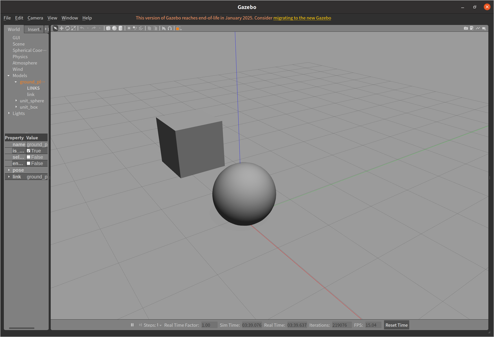
#### 5.3 Gazebo 物理引擎的概念
Gazebo 物理引擎是驱动 Gazebo 仿真的核心组件，通过算法模拟真实物理规律，让虚拟模型（如 box、机器人）的运动、碰撞、受力等行为贴合现实，包括动力学计算、碰撞检测、物理约束（如摩擦力、关节联动）等，还可适配 ODE/Bullet 等引擎，是仿真贴近真实的关键。

#### 六.ROS Bonus 任务实验报告

##### 任务一：使用自定义消息类型

###### 1.1 创建ROS功能包
```bash
cd ~/catkin_ws/src
catkin_create_pkg custom_msg_pkg rospy roscpp message_generation message_runtime std_msgs
```

###### 1.2 定义自定义消息文件
创建`msg`目录并定义`MyCustomMsg.msg`：
```bash
cd ~/catkin_ws/src/custom_msg_pkg
mkdir msg
gedit msg/MyCustomMsg.msg
```

在消息文件中添加以下内容：
```
string msg_name
int32 msg_id
float64 msg_value
std_msgs/Header header
```

###### 1.3 修改功能包配置文件
1. 修改`package.xml`，添加消息生成和运行时依赖：
```xml
<build_depend>message_generation</build_depend>
<exec_depend>message_runtime</exec_depend>
```

2. 修改`CMakeLists.txt`：
```cmake
find_package(catkin REQUIRED COMPONENTS
  roscpp
  rospy
  std_msgs
  message_generation
)

add_message_files(
  FILES
  MyCustomMsg.msg
)

generate_messages(
  DEPENDENCIES
  std_msgs
)

catkin_package(
  CATKIN_DEPENDS roscpp rospy std_msgs message_runtime
)
```

###### 1.4 编译自定义消息
```bash
cd ~/catkin_ws
catkin_make
source devel/setup.bash
```

###### 1.5 验证自定义消息
```bash
rosmsg show custom_msg_pkg/MyCustomMsg
```
输出结果：
```
string msg_name
int32 msg_id
float64 msg_value
std_msgs/Header header
  uint32 seq
  time stamp
  string frame_id
```

###### 1.6 编写发布/订阅节点
1. 发布节点（`custom_publisher.py`）：
```python
#!/usr/bin/env python3
import rospy
from custom_msg_pkg.msg import MyCustomMsg
from std_msgs.msg import Header

def custom_pub():
    rospy.init_node('custom_msg_publisher', anonymous=True)
    pub = rospy.Publisher('custom_msg_topic', MyCustomMsg, queue_size=10)
    rate = rospy.Rate(1)  # 1Hz
    
    while not rospy.is_shutdown():
        msg = MyCustomMsg()
        msg.header = Header()
        msg.header.stamp = rospy.Time.now()
        msg.msg_name = "test_msg"
        msg.msg_id = 1
        msg.msg_value = 3.14
        
        pub.publish(msg)
        rospy.loginfo("发布自定义消息：%s, %d, %.2f", 
                     msg.msg_name, msg.msg_id, msg.msg_value)
        rate.sleep()

if __name__ == '__main__':
    try:
        custom_pub()
    except rospy.ROSInterruptException:
        pass
```

2. 订阅节点（`custom_subscriber.py`）：
```python
#!/usr/bin/env python3
import rospy
from custom_msg_pkg.msg import MyCustomMsg

def callback(data):
    rospy.loginfo("接收自定义消息：")
    rospy.loginfo("名称：%s, ID：%d, 数值：%.2f", 
                 data.msg_name, data.msg_id, data.msg_value)

def custom_sub():
    rospy.init_node('custom_msg_subscriber', anonymous=True)
    rospy.Subscriber("custom_msg_topic", MyCustomMsg, callback)
    rospy.spin()

if __name__ == '__main__':
    custom_sub()
```

###### 1.7 运行发布/订阅节点
```bash
# 终端1：启动ROS核心
roscore

# 终端2：运行发布节点
cd ~/catkin_ws
source devel/setup.bash
rosrun custom_msg_pkg custom_publisher.py

# 终端3：运行订阅节点
cd ~/catkin_ws
source devel/setup.bash
rosrun custom_msg_pkg custom_subscriber.py
```

#### 任务二：Gazebo运行turtlebot3_gazebo仿真

###### 2.1 安装TurtleBot3相关包
```bash
sudo apt-get update
sudo apt-get install ros-noetic-turtlebot3 ros-noetic-turtlebot3-gazebo ros-noetic-turtlebot3-msgs
```

###### 2.2 设置TurtleBot3模型环境变量
```bash
echo "export TURTLEBOT3_MODEL=burger" >> ~/.bashrc
source ~/.bashrc
```

###### 2.3 启动Gazebo仿真环境
```bash
roslaunch turtlebot3_gazebo turtlebot3_empty_world.launch
```
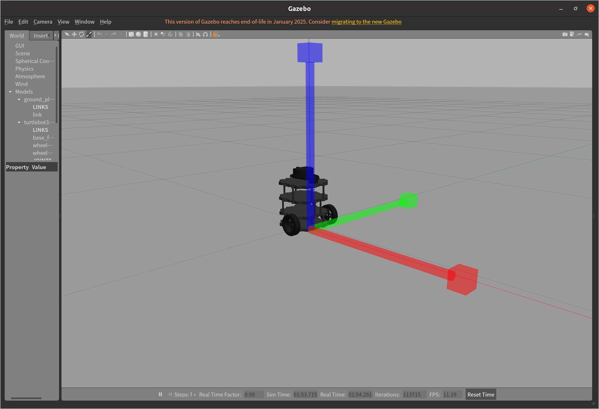

###### 2.4 控制TurtleBot3运动
```bash
roslaunch turtlebot3_teleop turtlebot3_teleop_key.launch
```
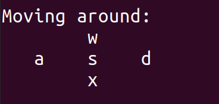

#### 任务三：使用rosbag录制和播放数据

###### 3.1 录制rosbag数据
```bash
cd ~/catkin_ws
rosbag record -O turtlebot3_data.bag /scan /odom /tf /tf_static
```

###### 3.2 查看bag文件信息
```bash
rosbag info turtlebot3_data.bag
```
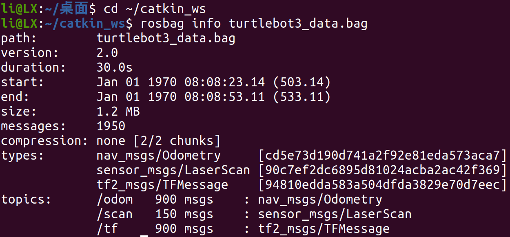

###### 3.3 播放rosbag数据
```bash
rosbag play turtlebot3_data.bag --loop
```

###### 3.4 RViz可视化bag数据
```bash
rviz
```

在RViz中进行如下配置：
1. 设置Fixed Frame为`base_link`
2. 添加LaserScan显示，设置Topic为`/scan`
3. 添加Odometry显示，设置Topic为`/odom`
4. 添加TF显示

#### 任务四：RViz显示激光或点云

###### 4.1 显示TurtleBot3仿真的实时激光数据
1. 启动TurtleBot3 Gazebo仿真：
```bash
roslaunch turtlebot3_gazebo turtlebot3_empty_world.launch
```

2. 启动RViz并配置：
```bash
rviz
```
- 设置Fixed Frame为`base_link`
- 添加LaserScan显示，设置Topic为`/scan`

###### 4.2 显示rosbag播放的激光数据
1. 播放之前录制的bag文件：
```bash
rosbag play turtlebot3_data.bag --loop
```

2. 在RViz中配置显示（同4.1）
---

## 三.遇到问题与解决方法
### 1.系统找不到名为subscriber_node的可执行文件
    原因分析：未正确编译，或 CMakeLists.txt 配置缺失
    解决方法：
    1. 重新执行catkin_make编译；
    2. 检查 CMakeLists.txt 中节点的编译配置；
    3. 验证devel/lib/my_pub_sub/下是否生成可执行文件

### 2.编译订阅者节点提示msg.data语法错误
    原因分析：msg是智能指针，需用->而非.访问成员
    解决方法：将msg.data.c_str()修改为msg->data.c_str()
    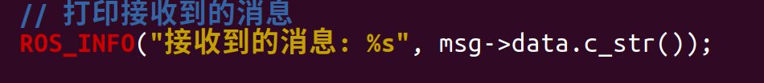

### 3.启动 Launch 时提示 “multiple nodes named [/turtlesim_node]”
    原因分析：ROS整个系统中的节点名称必须是唯一的，即使它们在不同的命名空间下，也不能重名
    解决方法：ROS 要求节点名全局唯一，将两个 turtlesim 节点的name属性改为不同值（如turtlesim_node1和turtlesim_node2）

### 4.RViz 中无turtle1坐标系
    原因分析：默认turtle1的 TF 未被 RViz 识别
    解决方案：重启turtlesim_node，刷新 RViz 的 TF 插件
---

## 四. 总结与心得
- 在...目录下创建...文件
1.打开终端，进入功能包目录
2.创建文件夹(scripts)
```shell
mkdir scripts
```
3.创建并编辑文件
进入scripts目录
```shell
cd scripts
```
用编辑器创建并打开文件
gedit follower_node.py

- 本周实验围绕 ROS 的核心通信机制、多节点管理、坐标变换及仿真工具展开，通过实践加深了对 ROS 系统的理解，主要收获如下：
1. Publisher 与 Subscriber 通信模式：成功实现了自定义话题的消息发布与订阅，掌握了节点创建、话题定义、消息类型使用的完整流程。在编写订阅者回调函数时，踩了智能指针访问方式的坑，深刻认识到 ROS 中指针使用的细节规范，也理解了ros::spin()与ros::spinOnce()在消息处理机制上的差异。
2. Launch 文件与命名空间：通过 launch 文件实现了多 turtlesim 节点的一键启动，学会了利用命名空间隔离节点资源，解决了节点重名冲突问题。同时掌握了话题重映射（remap）的用法，实现了键盘控制节点对指定乌龟的控制，体会到 launch 文件在多节点管理中的便捷性。
3. 控制算法实践：基于 P 控制实现了乌龟的跟随功能，通过计算位置差和角度差设计控制量，理解了简单比例控制在运动控制中的应用。调试过程中，通过调整比例系数 Ka 和 Kv，观察乌龟跟随效果的变化，直观感受到控制参数对系统性能的影响。
4. TF 坐标变换：熟悉了 TF 树的概念及作用，学会使用rosrun tf view_frames生成静态 TF 树文件、rqt_tf_tree实时可视化坐标关系，以及tf_echo验证变换参数。理解了机器人系统中多坐标系协同的必要性，以及 Fixed Frame 在 RViz 可视化中的基准作用。
5. 仿真工具使用：初步体验了 Gazebo 仿真环境，掌握了模型加载的基本操作，对物理引擎在仿真中的作用有了概念性认识。同时通过 RViz 可视化 TF 变换，加深了对坐标系相对关系的理解。