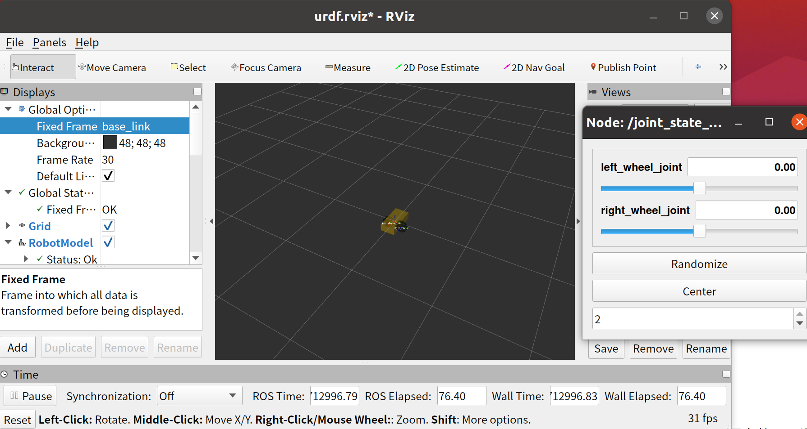
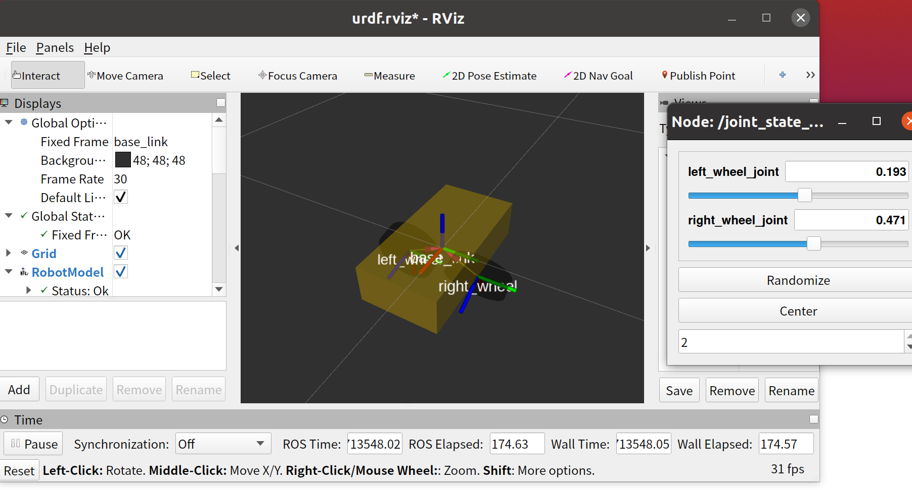
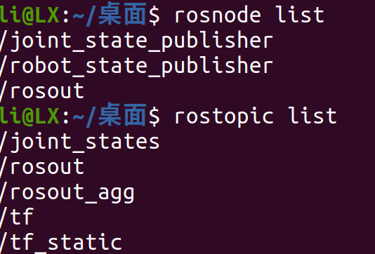
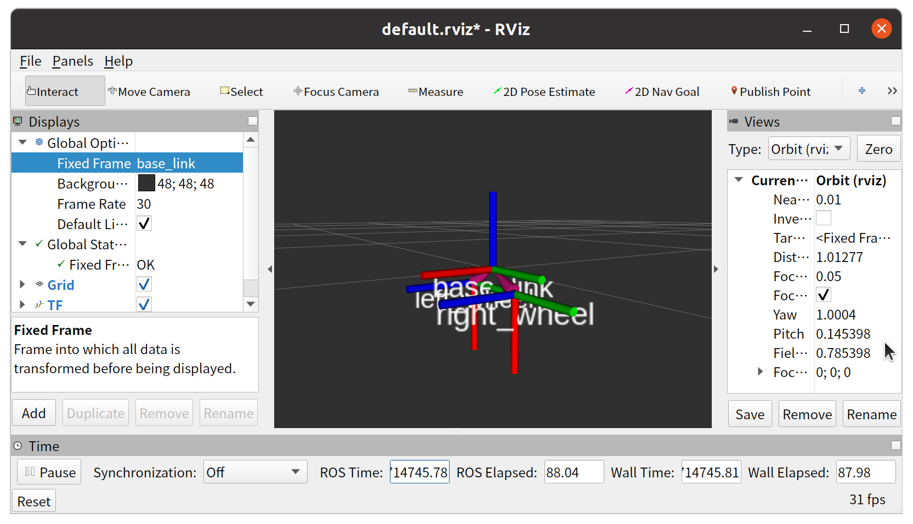
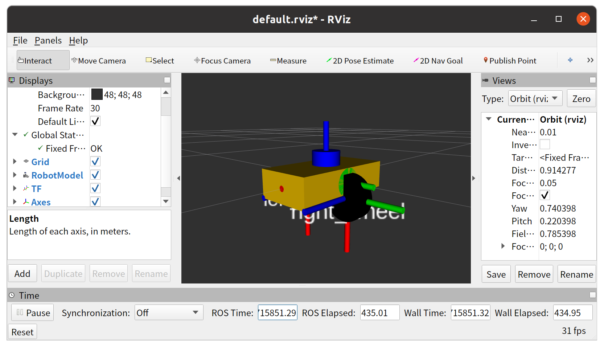

# Week4 实验报告

## 摘要
本报告记录了第 4 周实验全过程，核心完成两轮差速小车的 URDF 模型构建、TF 坐标变换发布及 RViz 可视化验证。实验掌握了 URDF 核心结构与编写规范，通过joint_state_publisher和robot_state_publisher节点实现关节状态与 TF 发布，在 RViz 中完成模型与坐标系的可视化配置，整理了实验中遇到的问题及解决方法，深化了对 URDF 与 TF 关系的理解。

## 实验环境
- 操作系统：Ubuntu 20.04
- ROS版本：Noetic
- 前提条件：catkin工作空间已创建（~/catkin_ws），并加载环境变量：
  source /opt/ros/noetic/setup.bash
  source ~/catkin_ws/devel/setup.bash
---
## **一.实验任务**
- 任务一:建立最小 URDF 两轮小车模型
- 任务二：使用 robotstatepublisher 发布 TF
- 任务三：RViz 中验证机器人模型与 TF
---

## 二.实现过程
### **任务一:建立最小 URDF 两轮小车模型**
#### 1.1 创建 ROS 功能包与 URDF 文件
1. 进入 ROS 工作空间的src目录，创建功能包（依赖 URDF 与 RViz 工具）：
```shell
cd ~/catkin_ws/src
catkin_create_pkg my_car_urdf urdf rviz
```
2. 在功能包内创建urdf目录，编写 URDF 文件（命名为two_wheeled_car.urdf）：
```xml
<?xml version="1.0"?>
<robot name="two_wheeled_car">

  <!-- 1. 定义base_link（小车主体） -->
  <link name="base_link">
    <!-- 可视化部分：用长方体表示小车车身 -->
    <visual>
      <geometry>
        <box size="0.4 0.2 0.1"/> <!-- 长0.4m、宽0.2m、高0.1m -->
      </geometry>
      <material name="yellow">
        <color rgba="1 0.8 0 1"/> <!-- 黄色，透明度1 -->
      </material>
    </visual>
  </link>

  <!-- 2. 定义left_wheel（左车轮） -->
  <link name="left_wheel">
    <!-- 可视化部分：用圆柱体表示车轮 -->
    <visual>
      <geometry>
        <cylinder length="0.05" radius="0.08"/> <!-- 厚度0.05m、半径0.08m -->
      </geometry>
      <material name="black">
        <color rgba="0 0 0 1"/> <!-- 黑色 -->
      </material>
    </visual>
  </link>

  <!-- 3. 定义right_wheel（右车轮） -->
  <link name="right_wheel">
    <!-- 可视化部分：和左车轮一致 -->
    <visual>
      <geometry>
        <cylinder length="0.05" radius="0.08"/>
      </geometry>
      <material name="black"/> <!-- 复用black材质 -->
    </visual>
  </link>

  <!-- 4. 连接left_wheel到base_link的joint -->
  <joint name="left_wheel_joint" type="continuous">
    <parent link="base_link"/>
    <child link="left_wheel"/>
    <!-- 车轮相对于车身的位置：车身左侧、底部（对齐车身高度） -->
    <origin xyz="0 -0.1 -0.05" rpy="0 1.5708 0"/> <!-- rpy转90度让圆柱立起来 -->
    <axis xyz="0 1 0"/> <!-- 车轮旋转轴为y轴（左右方向） -->
  </joint>

  <!-- 5. 连接right_wheel到base_link的joint -->
  <joint name="right_wheel_joint" type="continuous">
    <parent link="base_link"/>
    <child link="right_wheel"/>
    <!-- 车轮相对于车身的位置：车身右侧、底部 -->
    <origin xyz="0 0.1 -0.05" rpy="0 1.5708 0"/>
    <axis xyz="0 1 0"/> <!-- 同左车轮旋转轴 -->
  </joint>

</robot>
```
#### 1.2 模型可视化与验证
1. 编译工作空间并加载环境变量：
```shell
cd ~/catkin_ws
catkin_make
source devel/setup.bash
```
2. 启动 RViz 可视化模型（自动加载关节控制界面）：
```shell
roslaunch urdf_tutorial display.launch model:='$(find my_car_urdf)/urdf/two_wheeled_car.urdf' use_gui:=true
```


#### 1.3 每个 link 的含义
- base_link：小车的主体结构，作为模型的根链路，承载车轮等部件；
- left_wheel/right_wheel：小车的左右车轮，提供运动支撑与差速驱动功能。

#### 1.4 joint 在结构中的作用
joint是连接不同 link 的 “关节”，本模型中left_wheel_joint与right_wheel_joint将车轮与车身连接，同时定义了车轮的旋转轴，实现车轮相对于车身的连续转动，为差速控制提供基础。

### **任务二：使用 robotstatepublisher 发布 TF**
#### 2.1 创建 Launch 目录与文件
1. 进入功能包根目录，创建launch目录：
```shell
cd ~/catkin_ws/src/my_car_urdf
mkdir launch
```
2. 进入launch目录，编写 Launch 文件（命名为car_tf.launch）：
```shell
cd launch
vim car_tf.launch
```
写入：
```xml
<launch>
  <!-- 1. 加载URDF到参数服务器 -->
  <param name="robot_description" 
         command="$(find xacro)/xacro '$(find my_car_urdf)/urdf/two_wheeled_car.urdf'" />

  <!-- 2. 启动robot_state_publisher（发布TF） -->
  <node name="robot_state_publisher" 
        pkg="robot_state_publisher" 
        type="robot_state_publisher" />

  <!-- 3. 启动joint_state_publisher（发布关节状态） -->
  <node name="joint_state_publisher" 
        pkg="joint_state_publisher" 
        type="joint_state_publisher" />
</launch>
```
#### 2.2 启动 Launch 文件并验证
1. 编译工作空间并加载环境变量：
```shell
cd ~/catkin_ws
catkin_make
source devel/setup.bash
```
2. 启动 Launch 文件：
```shell
roslaunch my_car_urdf car_tf.launch
```
3. 验证节点与话题：
- 查看节点列表（rosnode list）
- 查看话题列表（rostopic list）


#### 2.3 可视化 TF 树
```shell
rviz
```


### **任务三：RViz 中验证机器人模型与 TF**
#### 3.1 启动 ROS 节点与 RViz
1. 启动任务 2 的 Launch 文件（加载 URDF、启动 TF 发布节点）：
```shell
cd ~/catkin_ws
source devel/setup.bash
roslaunch my_car_urdf car_tf.launch
```
2. 新开终端，启动 RViz
```shell
rviz
```
#### 3.2 RViz 配置
1. 设置 Fixed Frame：
  - 在 RViz 左侧Displays面板中，将Fixed Frame从默认的map修改为base_link（小车的根链路）。
2. 添加 RobotModel：
  - 点击Displays面板的Add按钮；
  - 选择RobotModel，点击OK；
  - 确认RobotModel的Description Topic为/robot_description（默认自动匹配），此时 RViz 中会显示两轮小车的可视化模型。
3. 添加 TF：
  - 再次点击Add，选择TF，点击OK；
  - 展开TF选项，可看到base_link、left_wheel、right_wheel的坐标变换关系（以彩色坐标系显示）。
4. 添加 Axes：
  - 点击Add，选择Axes，点击OK；
  - 调整Axes的Length（建议设为 0.1），可在模型上显示各链路的坐标轴（红色 = x 轴、绿色 = y 轴、蓝色 = z 轴）。

#### 3.3 验证显示效果
- 确认机器人模型显示正常：车身（黄色长方体）、左右车轮（黑色圆柱）完整显示；
- 确认TF 层级关系正确：left_wheel、right_wheel的坐标系以base_link为父节点，层级关系与 URDF 中的 joint 对应。


#### 3.4 简要说明:URDF 中的 joint 是如何对应 TF 关系的
URDF 中的 joint 定义了不同 link 的父子关系与相对位姿，robot_state_publisher会根据 joint 的配置，将这些关系转换为 TF 坐标变换并发布，例如left_wheel_joint对应base_link到left_wheel的 TF 关系。

---
## 三.遇到问题与解决方法
### 1.拖动关节滑块时，RViz 中车轮无视觉变化
    原因分析：拖动关节滑块车轮无视觉变化，要么是关节数据没传对（节点冲突、URDF 关节配置错），要么是视角 / 形状导致转了也没看出来。
    解决方法：
    1. 通过rostopic echo /joint_states验证关节数据是否正常发布；
    2. 调整 RViz 视角（放大车轮、切换到侧面视角）；

---
## 四.总结与心得
通过 “URDF 两轮小车模型构建、TF 发布、RViz 验证” 这一系列实验，我完整体验了 ROS 中机器人模型从 “代码编写” 到 “可视化验证” 的核心流程，不仅掌握了 URDF、Launch 文件的编写规范，更对 ROS 的节点通信、坐标变换等底层逻辑有了更具象的理解。

**实验总结**

本次实验围绕 “最小两轮差速小车” 展开，分三个阶段完成了核心任务：
- URDF 建模阶段：通过定义base_link、left_wheel、right_wheel三个链路，配合continuous类型的 joint 实现车轮与车身的连接，完成了机器人模型的 “物理结构描述”；
- TF 发布阶段：编写 Launch 文件整合了 URDF 加载、robot_state_publisher（TF 发布）、joint_state_publisher（关节状态发布）的启动逻辑，实现了模型位姿关系的 “数据化传递”；
- RViz 验证阶段：通过配置Fixed Frame、添加RobotModel/TF/Axes等显示项，直观验证了模型的可视化效果与坐标层级关系，完成了 “从代码到视觉” 的闭环。
