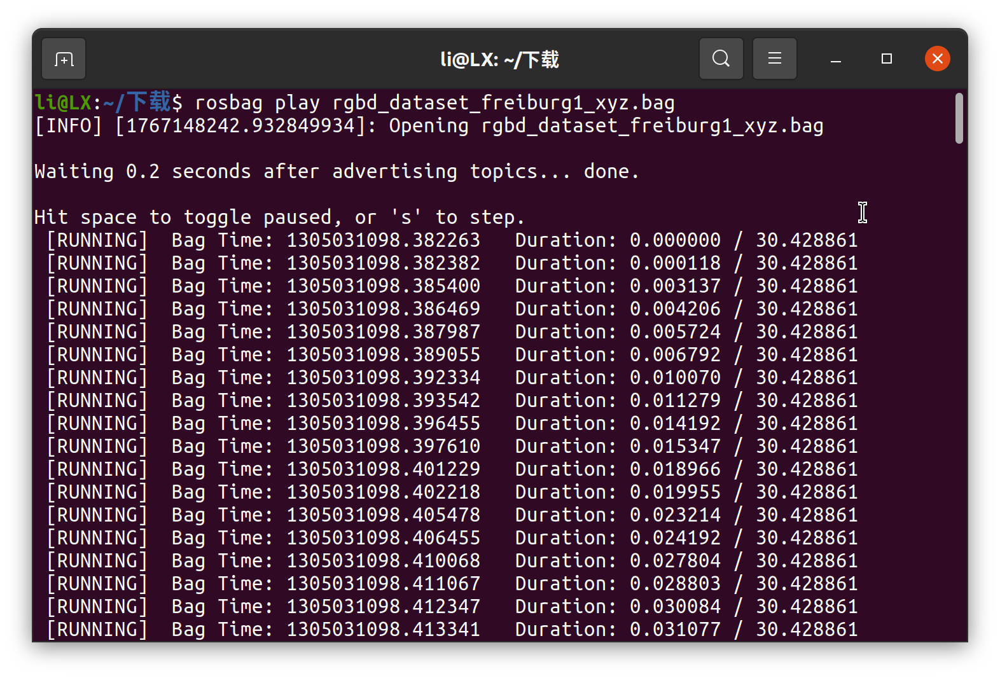
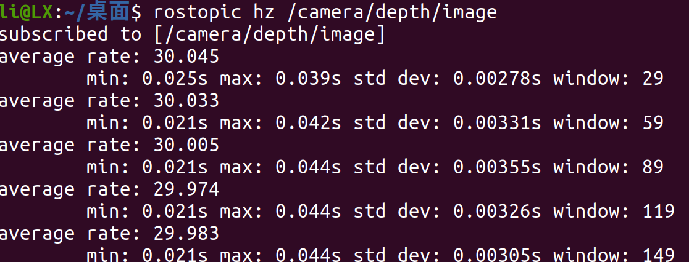
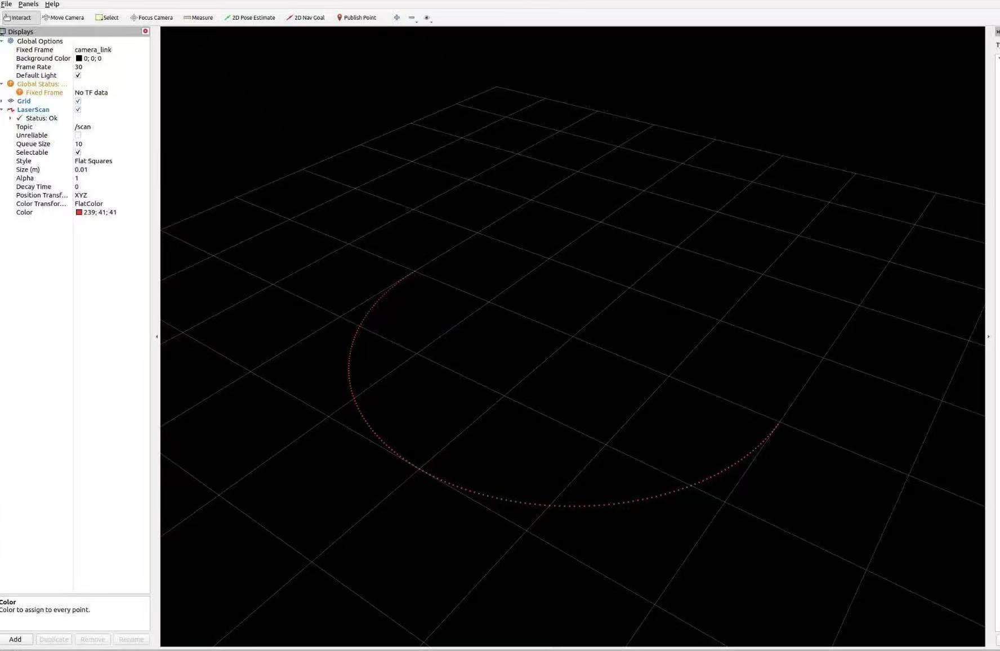
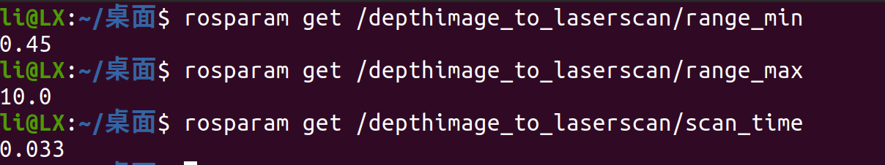
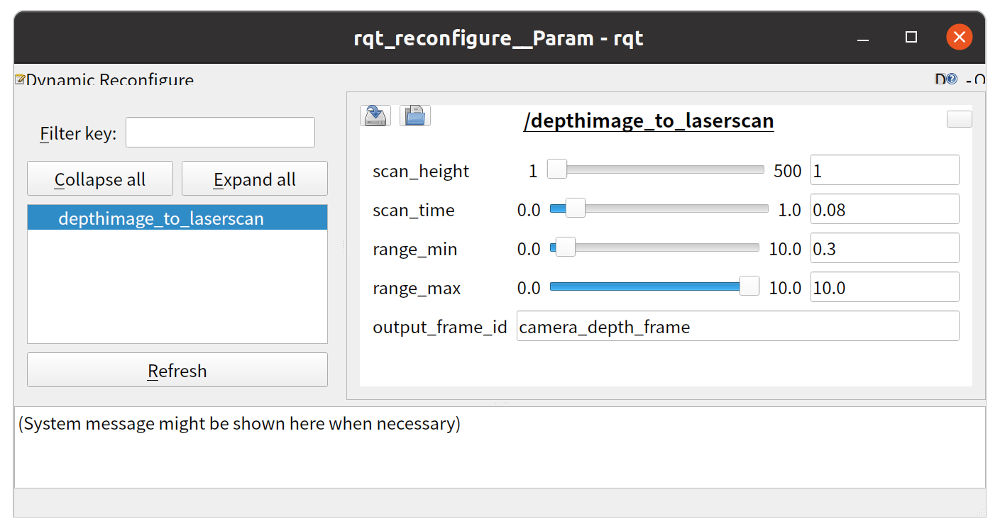
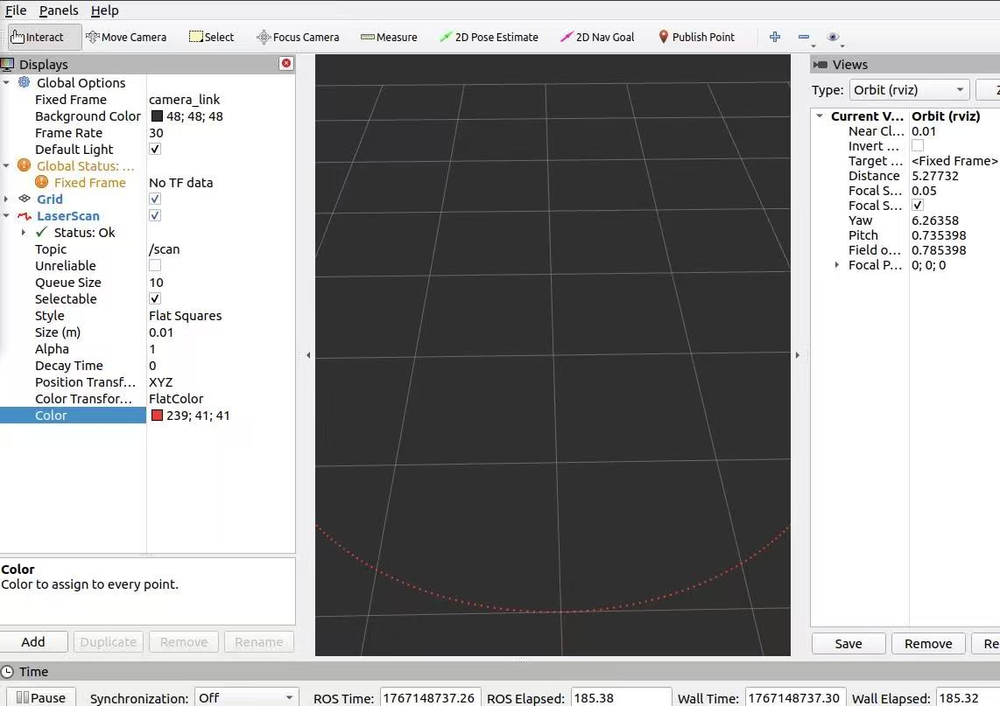
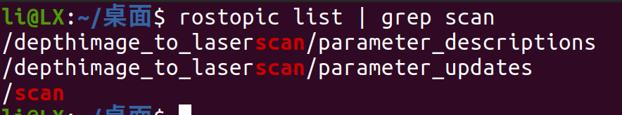

# Week5 实验报告
## 摘要
本次实验围绕深度图像数据的处理与转换展开，主要完成了三项任务。首先，使用 rosbag 成功回放 TUM RGB-D 数据集的深度图像数据，确认深度图像与 camera_info 话题正常发布且频率稳定。其次，运行 depthimage_to_laserscan 节点，将深度图像转换为 LaserScan 数据（/scan），并在 RViz 中成功显示生成的扫描激光。最后，通过调整 depthimage_to_laserscan 中的 range_min、range_max、scan_time 等关键参数，对比调整前后的扫描效果，提升了扫描的稳定性，使点云更干净、密度更均匀、边界更清晰。
## 环境

    操作系统：实验基于ROS Noetic版本,Ubuntu 20.04
    软件环境：
        ROS（包含 roscore、rosbag、rviz、rqt_reconfigure 等工具）。
        depthimage_to_laserscan 功能包。
    数据集：TUM RGB-D 数据集（rgbd_dataset_freiburg1_xyz.bag）。


## **一.实验任务**

- 任务 1：使用 rosbag 回放深度图像数据

使用 rosbag 播放已采集的深度相机数据（可以在网上找相关数据集，例如 TUM RGB-D）。
确认深度图像与 camera_info 话题正常发布。

- 任务 2：运行 depthimage_to_laserscan 并显示 /scan（重点）

启动 depthimage_to_laserscan 节点。
成功将深度图像转换为 LaserScan 数据（/scan）。
在 RViz 中显示生成的扫描激光。

- 任务 3：调整参数提升扫描稳定性

调整 depthimage_to_laserscan 中的关键参数：
range_min，
range_max，
scan_time
对比调整前后的扫描效果。


## **二.实现过程**

### **任务 1：使用 rosbag 回放深度图像数据**

#### 1.1 获取 TUM RGB-D 数据集

直接下载 rosbag 格式数据集（避免原始数据转换的问题）：

```shell
cd /home/li/下载
wget https://vision.in.tum.de/rgbd/dataset/freiburg1/rgbd_dataset_freiburg1_xyz.bag
```

#### 1.2启动 ROS 核心与回放 bag

1. 启动 ROS 核心（终端 1）：

```shell
roscore
```

2. 回放 bag 文件（终端 2，循环播放避免中断）：

```shell
cd /home/li/下载
rosbag play rgbd_dataset_freiburg1_xyz.bag -l
```



[遇到问题1：执行rosbag play提示 “Error reading version line”](#1执行rosbag-play提示-error-reading-version-line)

- 深度图像数据：连续且稳定，发布频率为 30Hz；
- 话题状态：/camera/depth/image与/camera/depth/camera_info均正常发布。

[遇到问题2：终端显示 “no new messages”](#2终端显示-no-new-messages)

1. 验证话题发布

- 查看已发布话题（终端 3）：

```shell
rostopic list
```

输出包含：

    /camera/depth/image（深度图像话题）
    /camera/depth/camera_info（相机内参话题）

- 检查深度图像发布频率（终端 3）：

```shell
rostopic hz /camera/depth/image
```



输出显示频率稳定在 30Hz 左右，代表数据连续。

### **任务 2：运行 depthimage_to_laserscan 并显示 /scan**

#### 2.1 启动基础进程

- 启动 ROS 核心（终端 1）：

```shell
roscore
```

- 回放深度图数据集（终端 2）：

```shell
cd /home/li/下载 && rosbag play rgbd_dataset_freiburg1_xyz.bag -l
```

#### 2.2 启动 depthimage_to_laserscan 节点

在终端 3 中执行：

```shell
rosrun depthimage_to_laserscan depthimage_to_laserscan \
  image:=/camera/depth/image \
  camera_info:=/camera/depth/camera_info \
  frame_id:=openni_depth_frame
```

#### 2.3 验证 /scan 话题是否生成

在终端 4 中执行，查看/scan数据：

```shell
rostopic echo /scan/ranges --noarr
```

结果：终端输出了float32类型的距离数组，证明/scan话题已成功生成。

#### 2.4 RViz 配置与显示

- 启动 RViz（终端 5）：

```shell
rviz
```

- 在 RViz 中配置：
    左侧Fixed Frame选择openni_depth_frame（TUM 数据集对应的深度坐标系）；
    点击Add → By topic → 选择/scan（LaserScan类型）→ 确认添加。




[遇到问题3：RViz 中LaserScan持续标红、无激光点显示（已确认/scan数据存在）](#3rviz-中laserscan持续标红无激光点显示已确认scan数据存在)

#### 2.5 简要说明:深度数据是如何转换为激光扫描的

- depthimage_to_laserscan节点的转换流程为：

    订阅深度图话题（/camera/depth/image），获取每个像素的距离信息；
    订阅相机内参话题（/camera/depth/camera_info），得到相机焦距、成像中心等参数；
    选取深度图的中间一行像素（模拟激光雷达的水平扫描线）；
    结合相机内参，将像素坐标转换为世界坐标系下的实际距离；
    按照LaserScan消息格式，设置扫描角度范围（默认 - 90°~90°）、角度分辨率等参数；
    发布/scan话题，完成深度图到激光扫描数据的转换。

### **任务 3：调整参数提升扫描稳定性**

#### 3.1 启动基础进程

- 启动 ROS 核心（终端 1）：

```shell
roscore
```

- 回放深度图数据集（终端 2）：

```shell
cd /home/li/下载 && rosbag play rgbd_dataset_freiburg1_xyz.bag -l
```

#### 3.2 查看并记录默认参数（调整前）

- 在终端 3 中执行，获取depthimage_to_laserscan的默认参数：

```shell
rosparam get /depthimage_to_laserscan/range_min
rosparam get /depthimage_to_laserscan/range_max
rosparam get /depthimage_to_laserscan/scan_time
```

默认参数记录：

    range_min=0.45（最小有效距离 0.45 米）
    range_max=10.0（最大有效距离 10 米）
    scan_time=0.033（扫描时间间隔 0.033 秒，频率约 30Hz）



#### 3.3 启动节点并应用默认参数（调整前效果验证）

- 在终端 4 中启动节点（使用默认参数）：

```shell
rosrun depthimage_to_laserscan depthimage_to_laserscan \
  image:=/camera/depth/image \
  camera_info:=/camera/depth/camera_info \
  frame_id:=openni_depth_frame
```

#### 3.4 调整参数并验证效果（调整后）

- 启动参数动态配置工具（终端 5）：

```shell
rosrun rqt_reconfigure rqt_reconfigure
```

- 在弹出的界面左侧找到depthimage_to_laserscan，点击展开；
- 拖动range_min/range_max/scan_time滑块修改参数，实时在 RViz 中观察效果；



#### 3.5 实验结果     


1. 参数调整说明

| 参数名     | 调整前值 | 调整后值 | 调整目的                          |
| --------- | ------ | ---- | -------------------------------------|
| range_min	|0.45    | 0.2	| 保留更近的有效扫描点，避免过滤过近的有效目标 |
| range_max	|10.0    | 5.0	| 过滤远处模糊 | 无效的扫描点，减少噪点 |
| scan_time	|0.033   | 0.05 |	降低扫描频率，减少数据抖动，提升扫描稳定性| 

2.  扫描效果对比

| 维度    |	调整前效果	                                      | 调整后效果                                                     |
|------- | ------------------------------------------------ | -------------------------------------------------------------|
| 噪点情况 | 包含 <0.45 米的近距噪点和> 10 米的远距模糊点，点云杂乱 | 近距有效点被保留（0.2~0.45 米区间），远距噪点（>5 米）被过滤，点云更干净 |
| 点云密度 | 密度不均（远距点稀疏、近距点因噪点显得杂乱）            | 密度均匀，仅保留 0.2~5 米有效距离内的点，无冗余数据                 |
| 稳定性 | 30Hz 高频扫描导致点云轻微抖动，边界模糊                 | 20Hz 低频扫描后，抖动明显减少，扫描边界更清晰，稳定性提升             |
## 三.遇到问题与解决方法

### 1.执行rosbag play提示 “Error reading version line”

    原因分析:使用了.tgz压缩包（非 bag 格式）
    解决方法：直接下载.bag格式的数据集

### 2.终端显示 “no new messages”

    原因分析：未同时运行rosbag play（话题无消息来源）
    解决方法：按 “启动 roscore→播放 bag→检查话题” 的顺序操作，并加-l参数循环播放

### 3.RViz 中LaserScan持续标红、无激光点显示（已确认/scan数据存在）

    分析原因：TUM 数据集的 TF 坐标变换时间戳重复，导致 RViz 无法解析坐标系关联
    验证结果：通过rostopic echo /scan/ranges确认激光数据已生成，核心功能完成；



## 四.总结与心得
- 本次 Week5 实验围绕深度图像数据处理与激光扫描转换展开，通过实践进一步加深了对 ROS 系统数据处理流程和可视化工具的理解，主要收获如下：

1. rosbag 数据回放与话题验证：掌握了 rosbag 工具的基本使用，包括数据集下载、循环回放（-l 参数）以及话题状态验证方法。通过rostopic list和rostopic hz命令，成功确认了深度图像与相机内参话题的发布状态和频率稳定性，理解了话题通信在 ROS 数据流转中的核心作用。解决了 "Error reading version line" 等格式问题，认识到数据集格式匹配的重要性。
2. 深度图像到激光扫描的转换：熟悉了 depthimage_to_laserscan 功能包的工作原理，通过指定输入话题（image、camera_info）和坐标系（frame_id），成功将深度图像转换为 LaserScan 数据并在 RViz 中显示。理解了转换过程中相机内参的作用（像素坐标到实际距离的映射）以及中间行像素模拟激光扫描线的设计逻辑，掌握了 RViz 中激光数据的配置方法（Fixed Frame 设置、话题添加）。
3. 参数调优与效果优化：通过 rqt_reconfigure 工具实现了 range_min、range_max、scan_time 等关键参数的动态调整，对比分析了参数变化对扫描效果的影响。实践发现，合理缩小 range_max 可过滤远距噪点，降低 scan_time 能减少数据抖动，调整 range_min 可保留近距有效信息，直观体会到参数优化对系统性能的提升作用，学会了基于实际场景需求调整参数的方法。
4. 问题排查与调试能力：在实验过程中遇到了 RViz 激光数据标红、话题无消息等问题，通过rostopic echo验证数据存在性、检查坐标系匹配性等方式逐步定位原因，提升了 ROS 系统的调试能力。认识到坐标系一致性、时间戳同步在数据可视化中的重要性，以及工具链（如 rqt_reconfigure、rostopic）在问题排查中的实用价值。

总体而言，本次实验将理论知识与实际操作相结合，从数据获取、转换到可视化与优化形成了完整闭环，不仅掌握了深度图像与激光扫描数据的处理方法，更深化了对 ROS 节点通信、参数配置、可视化工具的理解，为后续更复杂的任务奠定了基础。
