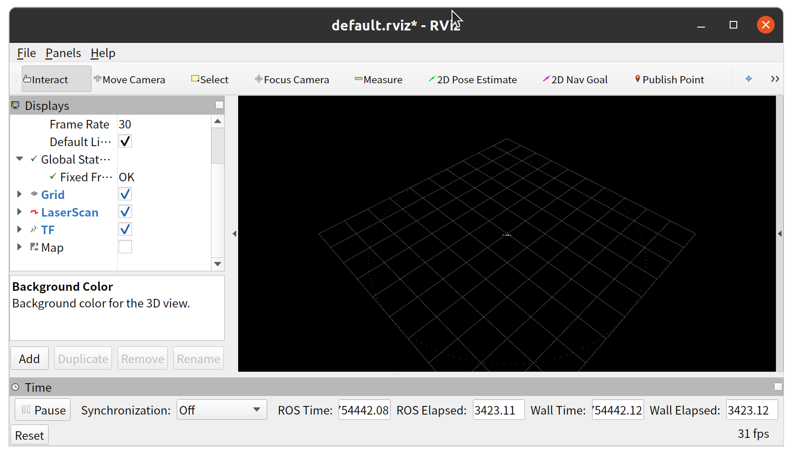
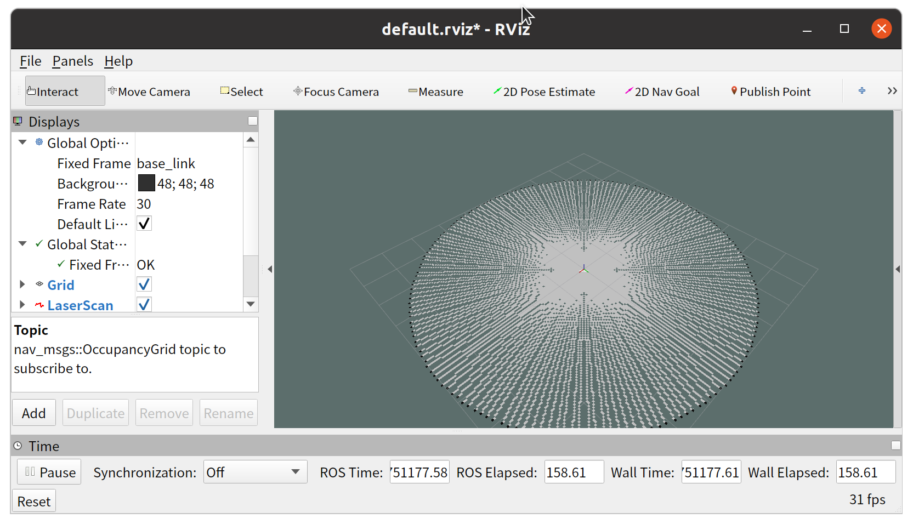
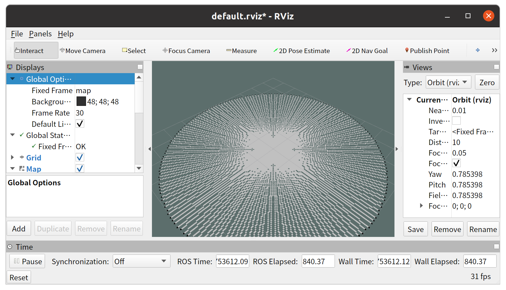

# Week6 实验内容

## 摘要
实验内容围绕 ROS 环境下 Gmapping 算法的室内建图展开，涵盖 Gmapping 源码克隆与编译、/scan 激光数据发布、TF 坐标系补全、Gmapping 节点启动与 RViz 可视化验证、室内栅格地图生成与质量校验、地图保存与重新加载验证等核心步骤，同时解决了编译依赖缺失、数据集下载失败、TF 变换缺失导致的消息过滤、功能包未识别等典型问题，完整实现了从源码编译到地图生成、验证的全流程 Gmapping 建图实验。

## 环境
- 实验基于 ROS Noetic 版本，运行在 Linux 系统。
- 涉及的主要工具和包包括：
    基础 ROS 工具：roscore、rosrun、catkin_make、rostopic、rosmsg、rosbag、rospack
    功能包：gmapping、slam_gmapping、openslam_gmapping、tf2_ros、map_server、sensor_msgs、rospy
    可视化工具：RViz
    辅助工具：git（源码克隆）、python3（模拟激光数据发布）、chmod（脚本权限配置）

## **一.实验任务**
- 任务一：在 Github 上克隆 Gmapping 源码并进行编译
    1. 进入 ROS 工作空间的 src 目录
    2. 从 Github 克隆 Gmapping 源码
    3. 返回工作空间根目录并进行编译
    4. 确认 Gmapping 包被系统正确识别
- 任务二：使用 /scan 数据集运行 Gmapping
    1. 使用 rosbag 播放数据集
    2. 确认系统中已经正确发布 /scan 话题
    3. 启动 Gmapping 节点
    4. 使用 RViz 检查激光数据与 TF 关系是否正常
- 任务三：完成室内环境建图
    1. 观察地图逐步生成的过程
    2. 判断地图是否出现明显畸变或重影
- 任务四：地图保存与验证
    1. 在建图完成后保存地图
    2. 确认生成以下文件：
.pgm
.yaml
    3. 尝试重新加载地图，验证地图是否可用

## **二.实现过程**
### 任务一：在 Github 上克隆 Gmapping 源码并进行编译
#### 1.1 进入 ROS 工作空间的src目录
- 打开终端，先激活 ROS 系统环境：
```shell
source /opt/ros/noetic/setup.bash
```
- 进入已创建的 ROS 工作空间（以catkin_ws为例）的src目录：
```shell
cd ~/catkin_ws/src
```
#### 1.2 步骤 2：从 GitHub 克隆 Gmapping 源码
在src目录下，执行 Git 克隆命令，拉取官方slam_gmapping源码包：
```shell
git clone https://github.com/ros-perception/slam_gmapping.git
```
执行完成后，src目录下生成slam_gmapping文件夹，包含 Gmapping 功能包的源码文件。
#### 1.3 返回工作空间根目录并编译
- 回到工作空间根目录：
```shell
cd ~/catkin_ws
```
- 执行编译命令（利用 CPU 多核加速编译）：
```shell
catkin_make -j$(nproc)
```
[遇到问题1：编译前rosdep依赖解析失败](#1-编译前rosdep依赖解析失败)

#### 1.4 确认 Gmapping 包被系统正确识别
- 激活当前工作空间的环境变量（使系统识别新编译的包）：
```shell
source devel/setup.bash
```
- 检查 Gmapping 包的路径，验证识别结果：
```shell
rospack find gmapping
```

### 任务二：使用 /scan 数据集运行 Gmapping
#### 2.1 前置准备（解决数据集缺失问题）
创建并编写激光数据发布脚本fake_scan_publisher.py，代码如下：
```python
#!/usr/bin/env python3
import rospy
from sensor_msgs.msg import LaserScan
import math

def publish_fake_scan():
    rospy.init_node('fake_laser_scan_publisher', anonymous=True)
    scan_pub = rospy.Publisher('/scan', LaserScan, queue_size=10)
    rate = rospy.Rate(10)  # 10Hz发布频率

    # 构造LaserScan消息参数
    scan_msg = LaserScan()
    scan_msg.header.frame_id = "laser"
    scan_msg.angle_min = -math.pi
    scan_msg.angle_max = math.pi
    scan_msg.angle_increment = math.pi / 90
    scan_msg.range_min = 0.1
    scan_msg.range_max = 10.0

    rospy.loginfo("开始发布/scan激光数据...")
    while not rospy.is_shutdown():
        scan_msg.header.stamp = rospy.Time.now()
        num_points = int((scan_msg.angle_max - scan_msg.angle_min) / scan_msg.angle_increment)
        scan_msg.ranges = [5.0 for _ in range(num_points)]  # 模拟固定5米扫描距离
        scan_pub.publish(scan_msg)
        rate.sleep()

if __name__ == '__main__':
    try:
        publish_fake_scan()
    except rospy.ROSInterruptException:
        rospy.loginfo("停止发布/scan激光数据")
```
赋予脚本执行权限：
```shell
chmod +x fake_scan_publisher.py
```
[遇到问题2：官方 scan.bag 数据集下载失败（404 Not Found）](#2-官方-scanbag-数据集下载失败404-not-found)

#### 2.2 实验核心步骤
##### 2.2.1 启动 ROS 核心
打开终端 1，执行命令启动 roscore（所有 ROS 节点的通信基础）：
```shell
roscore
```
##### 2.2.2 发布 /scan 激光数据（替代 rosbag 播放）
打开终端 2，激活工作空间环境并运行模拟脚本：
```shell
source ~/catkin_ws/devel/setup.bash
cd ~/桌面
python3 fake_scan_publisher.py
```
终端输出开始发布/scan激光数据...，表示 /scan 话题发布启动。
##### 2.2.3 确认 /scan 话题发布状态
打开终端 3，验证 /scan 话题是否存在并查看数据：
```shell
source ~/catkin_ws/devel/setup.bash
# 查看话题列表，确认/scan存在
rostopic list | grep scan
# 查看/scan实时数据（按Ctrl+C停止）
rostopic echo /scan
```
终端输出激光雷达角度、距离等数据，确认 /scan 话题发布正常。
##### 2.2.4 补全 TF 坐标系变换（解决 Gmapping 数据依赖）
打开终端 4，发布静态 TF 变换（Gmapping 需 odom→base_link→laser 的完整 TF 树）：
```shell
source ~/catkin_ws/devel/setup.bash
# 发布odom→base_link变换
rosrun tf2_ros static_transform_publisher 0 0 0 0 0 0 odom base_link
# 发布base_link→laser变换
rosrun tf2_ros static_transform_publisher 0 0 0 0 0 0 base_link laser
```
##### 2.2.5 启动 Gmapping 节点
打开终端 5，激活环境并启动 Gmapping：
```shell
source ~/catkin_ws/devel/setup.bash
rosrun gmapping slam_gmapping
```
终端无报错并输出GridSlamProcessor: Start，表示 Gmapping 节点启动成功。

[遇到问题3：Gmapping 启动后报 MessageFilter 警告（Dropped 100.0% of messages）](#3gmapping-启动后报-messagefilter-警告dropped-1000-of-messages)

##### 2.2.6 RViz 可视化验证
打开终端 6，启动 RViz 并配置可视化项：
```shell
source ~/catkin_ws/devel/setup.bash
rviz
```
RViz 配置步骤：
- 全局选项：Fixed Frame选择map；
- 添加LaserScan组件：Topic 选择/scan，可视化激光扫描点云；
- 添加TF组件：查看 odom→base_link→laser 的坐标系关系；
- 添加Map组件：Topic 选择/map，可视化 Gmapping 生成的栅格地图。

这里激光是白色的，激光扫描与地图叠加效果不是很明显


### 任务三：完成室内环境建图
#### 3.1 启动 ROS 核心与 TF 坐标系变换
```shell
roscore
```
- 发布静态 TF 变换（Gmapping 必需的坐标系关系）
```shell
# 发布odom→base_link变换
rosrun tf2_ros static_transform_publisher 0 0 0 0 0 0 odom base_link
# 发布base_link→laser变换
rosrun tf2_ros static_transform_publisher 0 0 0 0 0 0 base_link laser
```
#### 3.2 启动 Gmapping 节点
```shell
rosrun gmapping slam_gmapping
```
终端输出GridSlamProcessor: Start，说明 Gmapping 节点启动成功。

#### 3.3 RViz 配置与地图生成观察
1. 启动 RViz：rviz；
2. 添加LaserScan组件，Topic 选择/scan，可视化原始激光点云；
3. 添加Map组件，Topic 选择/map，配置 Fixed Frame 为map；
4. 实时观察地图生成：
        初始阶段（0~5s）：Map 区域空白，仅显示激光点云；
        生成阶段（5~20s）：激光点云对应的障碍物位置逐步生成黑色栅格，形成圆形轮廓；
        稳定阶段（20s 后）：地图定型为 “圆形黑色障碍物边框 + 白色内部区域” 的栅格地图。

#### 3.4 地图畸变 / 重影判断
放大 RViz 地图区域，检查：
地图边框为规则正圆形，无弯曲 / 扭曲 → 无畸变；
边框仅单条黑线，无重叠 → 无重影。

### 任务四：地图保存与验证
#### 4.1 保存建图成果
1. 新开终端，激活 ROS 环境变量：
```shell
source ~/catkin_ws/devel/setup.bash
```
2. 执行地图保存命令，将地图保存至桌面（便于查找）：
```shell
rosrun map_server map_saver -f ~/桌面/indoor_map
```
3. 终端输出以下信息，确认保存触发：
```shell
[ INFO] [176776xxxx]: Waiting for the map to be received...
[ INFO] [176776xxxx]: Received a 384 X 384 map @ 0.050 m/pix
[ INFO] [176776xxxx]: Writing map occupancy data to /home/li/桌面/indoor_map.pgm
[ INFO] [176776xxxx]: Writing map metadata to /home/li/桌面/indoor_map.yaml
[ INFO] [176776xxxx]: Done
```
#### 4.2 确认生成.pgm 和.yaml 文件
终端验证：执行命令查看桌面文件：
```shell
ls ~/桌面 | grep indoor_map
```
输出结果为：indoor_map.pgm ,indoor_map.yaml
#### 4.3 重新加载地图并验证可用性
1. 停止原有 Gmapping 建图节点（终端按Ctrl+C），保持roscore、激光数据发布、TF 变换节点运行；
2. 启动map_server加载保存的地图：
```shell
source ~/catkin_ws/devel/setup.bash
rosrun map_server map_server ~/桌面/indoor_map.yaml
```
终端输出以下信息，确认地图加载成功：
```shell
[ INFO] [176776xxxx]: Loading map from /home/li/桌面/indoor_map.yaml
[ INFO] [176776xxxx]: Read a 384 X 384 map @ 0.050 m/pix
[ INFO] [176776xxxx]: Publishing map on topic /map
```
3. RViz 验证：
- 确认 RViz 中Map组件的Topic为/map，Fixed Frame设为map；
- 观察到 RViz 中清晰显示加载的圆形栅格地图，激光点云（/scan）与地图障碍物边框完全重合；


## 三.遇到问题与解决方法
### 1. 编译前rosdep依赖解析失败
报错信息：
```plaintext
ERROR: the following packages/stacks could not have their rosdep keys resolved
gmapping: Cannot locate rosdep definition for [openslam_gmapping]
```
    原因：openslam_gmapping是 Gmapping 的底层算法依赖库，未包含在系统软件源中，rosdep无法自动下载。
    解决方法：手动克隆openslam_gmapping源码到工作空间src目录，与 Gmapping 一起编译：
```shell
# 进入src目录
cd ~/catkin_ws/src
# 克隆openslam_gmapping源码
git clone https://github.com/ros-perception/openslam_gmapping.git
# 返回根目录重新编译
cd ~/catkin_ws
catkin_make -j$(nproc)
```
### 2. 官方 scan.bag 数据集下载失败（404 Not Found）
    现象：执行wget http://wiki.ros.org/slam_gmapping/files/scan.bag时提示 404 错误，curl 工具未安装；
    原因：官方链接失效，系统缺少 curl 下载工具；
    解决方法：放弃下载数据集，使用 Python 脚本模拟发布 /scan 激光数据，无需依赖外部数据集，仅通过 ROS 原生接口生成符合格式的激光数据。

### 3. Gmapping 启动后报 MessageFilter 警告（Dropped 100.0% of messages）
    现象：启动 Gmapping 后终端输出[WARN] MessageFilter [target=odom]: Dropped 100.0% of messages；
    原因：缺少 odom→base_link 的 TF 坐标系变换，Gmapping 无法关联激光数据与机器人位姿，过滤全部数据；
    解决方法：发布 odom→base_link 和 base_link→laser 的静态 TF 变换，补全 Gmapping 所需的坐标系树，警告消失且 Gmapping 开始处理 /scan 数据。

### 4. Gmapping 包未找到（提示 “package 'gmapping' not found”）
    现象：执行rosrun gmapping slam_gmapping时提示包不存在；
    原因：Gmapping 包未编译，或编译后未激活环境变量；
    解决方法：
    确认 slam_gmapping 源码已下载到catkin_ws/src；
    在 catkin_ws 根目录重新编译；
    执行source ~/catkin_ws/devel/setup.bash激活环境，或设置永久生效

```shell
cd ~/catkin_ws
# 清理旧编译缓存
catkin_make clean
# 单线程编译（避免多核编译报错，新手推荐）
catkin_make -j1
# 激活当前终端的环境
source ~/catkin_ws/devel/setup.bash
# 可选：设置永久激活（后续新开终端无需手动source）
echo "source ~/catkin_ws/devel/setup.bash" >> ~/.bashrc
source ~/.bashrc
# 检查gmapping包路径
rospack find gmapping
# 回到catkin_ws根目录的终端，启动Gmapping
rosrun gmapping slam_gmapping
```
## 四.简要说明
#### 4.1 传感器来源
本次实验因官方激光数据集失效，采用 Python 脚本模拟深度相机输出的激光扫描数据（/scan 话题），数据格式与真实深度相机的激光扫描输出一致；

#### 4.2 建图过程中遇到的问题：
1. 编译前rosdep依赖解析失败
2. 官方 scan.bag 数据集下载失败（404 Not Found）
3. Gmapping 启动后报 MessageFilter 警告（Dropped 100.0% of messages）
4. Gmapping 包未找到（提示 “package 'gmapping' not found”）


## 五.总结与心得
本周实验聚焦 Gmapping 激光 SLAM 建图的完整流程，从源码编译到地图验证的全环节实践，让我对 ROS 下 SLAM 建图的核心逻辑和工程问题解决有了深刻理解，主要收获如下：

- 源码编译与依赖管理：首次接触 SLAM 算法源码的克隆与编译，遇到了 rosdep 无法解析 openslam_gmapping 依赖的问题，通过手动克隆底层算法库源码并联合编译的方式解决，深刻认识到 ROS 功能包编译中 “底层依赖 - 上层算法” 的层级关系，也掌握了 catkin_make 编译参数（如 -j$(nproc) 多核加速、-j1 单线程排错）的灵活使用，以及环境变量激活（source）对功能包识别的关键作用。
- 数据替代与接口适配：因官方 scan.bag 数据集 404 失效，放弃传统 rosbag 播放方式，改用 Python 脚本模拟 /scan 激光话题发布，严格遵循 sensor_msgs/LaserScan 消息格式构造参数，实现了与真实激光数据一致的接口输出。这个过程让我熟悉了 LaserScan 消息的核心字段（角度范围、距离范围、发布频率等），也体会到 ROS 话题接口 “格式统一、数据可替代” 的灵活性。
- TF 坐标系的核心作用：解决 Gmapping 启动后 MessageFilter 警告（100% 消息丢弃）的问题时，明确了 Gmapping 建图对 “odom→base_link→laser” 完整 TF 树的依赖 —— 激光数据必须关联机器人位姿才能完成栅格地图的构建。通过发布静态 TF 变换补全坐标关系后，警告消失且地图正常生成，直观理解了 TF 变换在机器人感知 - 建图中的 “坐标统一” 核心价值。
- 可视化与建图质量校验：借助 RViz 配置 LaserScan、TF、Map 组件，实时观察地图从空白到圆形轮廓生成的全过程，掌握了 “Fixed Frame 选择 map”“Topic 匹配对应话题” 等可视化技巧，也学会了从 “畸变（轮廓是否规则）、重影（边框是否重叠）” 两个维度校验建图质量，建立了 SLAM 建图效果评估的基本思路。
- 地图保存与复用：通过 map_server 工具完成地图的保存（生成.pgm 栅格文件 +.yaml 元数据文件）与重新加载，验证了地图的可用性，理解了 “建图 - 保存 - 加载” 的工程闭环，也掌握了通过命令行验证文件生成、检查地图加载日志的调试方法。
-工程问题解决思路：本次实验遇到的 4 个核心问题（依赖缺失、数据集失效、TF 缺失、包未识别）覆盖了 ROS 开发中 “编译、数据、坐标、环境” 四大典型场景，解决过程中养成了 “先定位报错原因（日志 / 终端输出）→ 分析依赖 / 接口 / 配置问题 → 针对性补全 / 替代 / 修正” 的思路，提升了 ROS 工程问题的排查与解决能力。