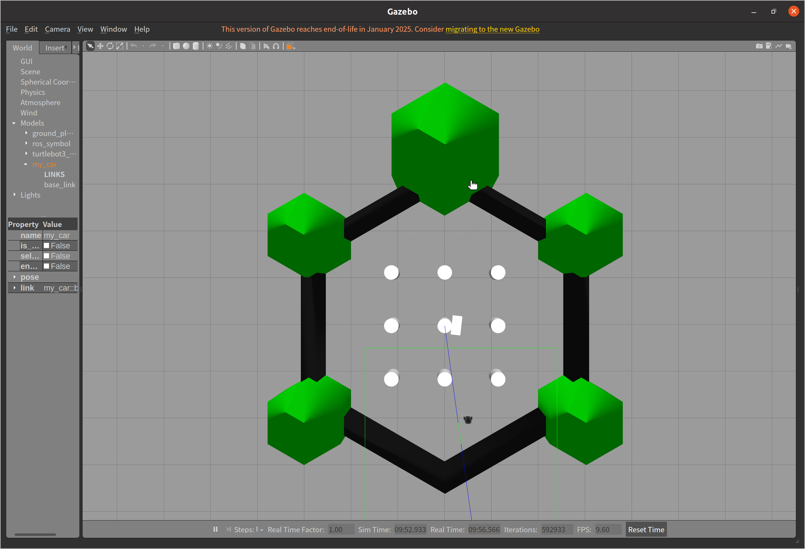
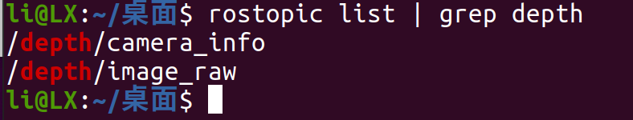
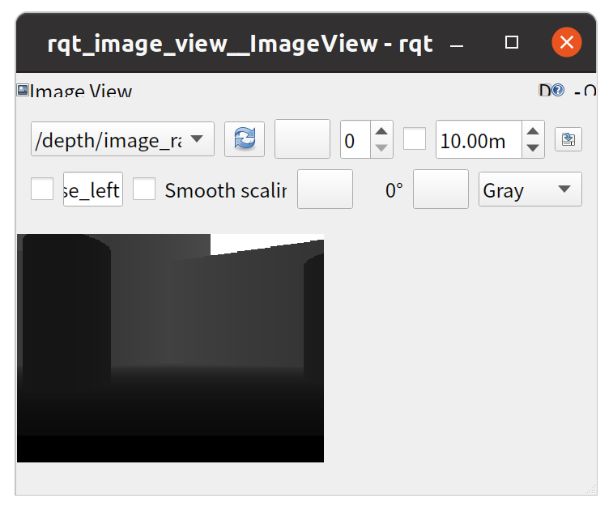
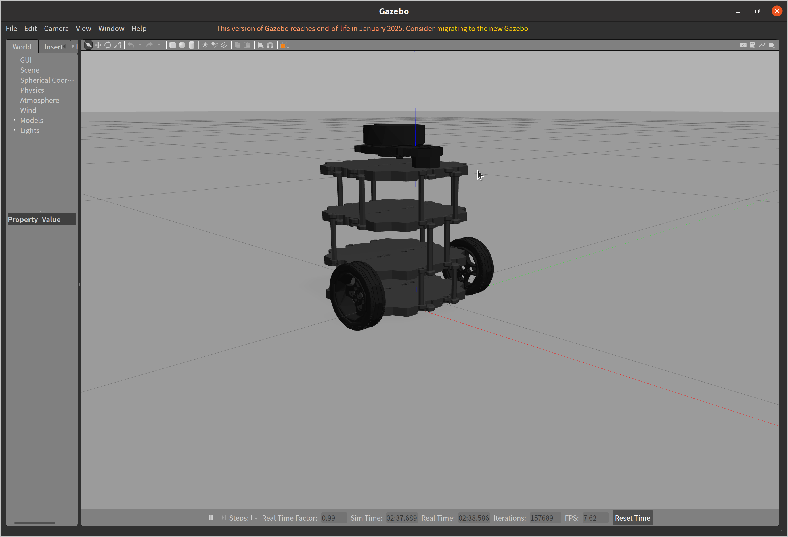
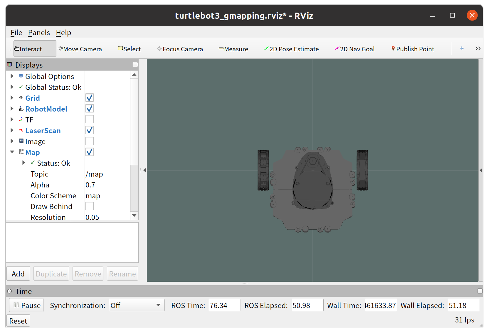
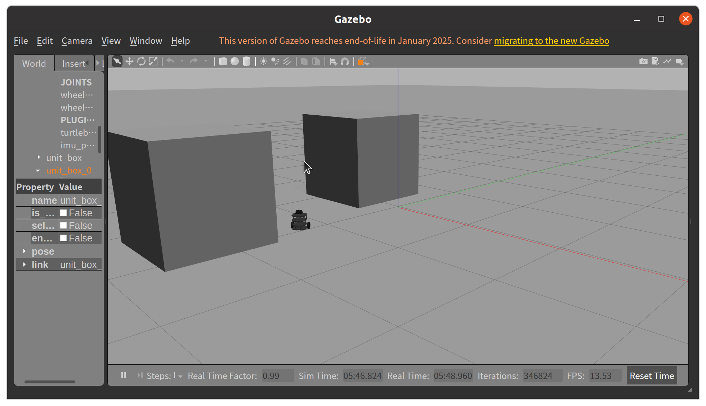
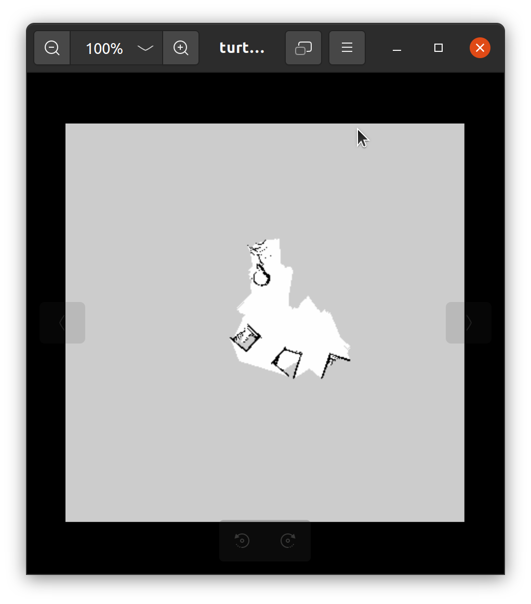
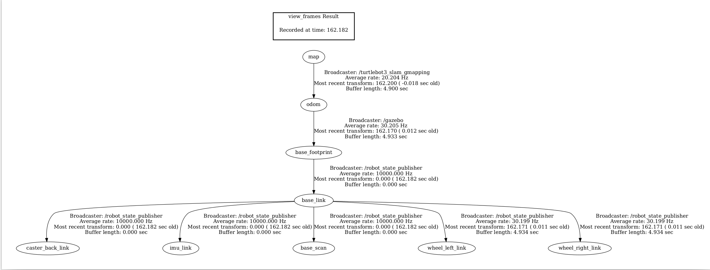

# Week7实验报告

## 摘要
本次 Week7 实验围绕 ROS 仿真环境下深度相机应用与 SLAM 建图展开，核心内容涵盖：基于 Gazebo 创建内置深度相机的自定义小车模型（解决官方 TurtleBot3 模型深度相机话题缺失问题）、通过 depthimage_to_laserscan 功能包实现深度图到激光扫描 /scan 话题的转换、在 TurtleBot3 仿真环境中运行 Gmapping 算法完成 SLAM 建图，以及利用 RViz 可视化验证激光数据、地图生成和 TF 坐标系变换的完整性。实验过程中排查并解决了官方模型深度相机加载失败、catkin_make 编译报错、depthimage_to_laserscan 节点启动失败等关键问题，最终实现了深度相机数据正常发布、深度图转激光扫描数据有效输出、Gmapping 建图实时更新及 RViz 全流程可视化验证，掌握了 ROS 仿真环境下深度感知与 SLAM 建图的核心流程和调试方法。

## 环境
- 实验基于 ROS Noetic 版本，运行在 Linux 系统。涉及的主要工具和包包括：
  基础 ROS 工具：roscore、rosrun、roslaunch、rostopic、rosmsg、catkin_make、source 等

  核心功能包：urdf、gazebo_ros、rospy、roscpp、depthimage_to_laserscan、gmapping、turtlebot3_gazebo、turtlebot3_slam、teleop_twist_keyboard、map_server、tf 等辅助工具 / 依赖：cv_bridge、numpy（仿真深度图生成）、rqt_image_view（深度图查看）、rviz（可视化）、gazebo（仿真环境）、evince（TF 树 PDF 查看）自定义功能包：my_depth_car（自定义深度相机小车模型）、depth2scan（深度图转激光扫描）
---
## **一.实验任务**
- 任务一：启动内置深度相机的 Gazebo 小车模型
- 任务二：将深度图转换为激光扫描 /scan
- 任务三：在仿真环境中运行 Gmapping
- 任务四：RViz 可视化与结果验证

---
## 二.实现过程
### 任务一：启动内置深度相机的 Gazebo 小车模型
#### 1.1 实验前期准备
- 打开终端，加载 ROS 核心环境变量，确保 ROS 基础环境可用：
```shell
source /opt/ros/noetic/setup.bash
```
#### 1.2 尝试官方 TurtleBot3 模型（前期排查）
1. 设置 TurtleBot3 模型环境变量：
```shell
export TURTLEBOT3_MODEL=burger
```
2. 启动官方 Gazebo 仿真模型：
```shell
roslaunch turtlebot3_gazebo turtlebot3_world.launch
```
3. 检查深度相机话题，执行命令
```shell
rostopic list | grep depth
```
结果：无任何输出，深度相机话题未发布；进一步执行rosnode list，未发现相机相关节点，判定官方模型因配置 / 依赖问题无法正常加载深度相机。

#### 1.3终极方案：从零创建无依赖的深度相机小车模型
##### 1.3.1 创建 ROS 工作空间与功能包
```shell
# 创建全新工作空间，避免与旧配置冲突
mkdir -p ~/new_catkin_ws/src
cd ~/new_catkin_ws/src

# 创建功能包，仅依赖核心ROS/Gazebo库
catkin_create_pkg my_depth_car urdf gazebo_ros rospy roscpp

# 进入功能包，创建URDF和Launch文件目录
cd my_depth_car
mkdir urdf launch
```
##### 3.3.2 编写 URDF 文件（定义小车 + 深度相机）
创建并编辑car_with_depth.urdf文件，定义小车底盘、深度相机结构及 Gazebo 深度相机插件：
```shell
gedit ~/new_catkin_ws/src/my_depth_car/urdf/car_with_depth.urdf
```
```xml
<?xml version="1.0"?>
<robot name="my_car">
  <!-- 1. 小车底盘定义 -->
  <link name="base_link">
    <visual>
      <geometry><box size="0.4 0.2 0.1"/></geometry>
      <material name="gray"><color rgba="0.5 0.5 0.5 1"/></material>
    </visual>
    <collision><geometry><box size="0.4 0.2 0.1"/></geometry></collision>
    <inertial><mass value="2.0"/><inertia ixx="0.01" ixy="0" ixz="0" iyy="0.01" iyz="0" izz="0.01"/></inertial>
  </link>

  <!-- 2. 深度相机链接（可视化+碰撞属性） -->
  <link name="depth_camera_link">
    <visual>
      <geometry><box size="0.05 0.05 0.03"/></geometry>
      <material name="red"><color rgba="1 0 0 1"/></material>
    </visual>
    <collision><geometry><box size="0.05 0.05 0.03"/></geometry></collision>
  </link>

  <!-- 3. 相机固定在底盘前上方 -->
  <joint name="camera_joint" type="fixed">
    <parent link="base_link"/>
    <child link="depth_camera_link"/>
    <origin xyz="0.1 0 0.08" rpy="0 0 0"/>
  </joint>

  <!-- 4. Gazebo深度相机插件（核心：发布深度话题） -->
  <gazebo reference="depth_camera_link">
    <sensor type="depth" name="depth_camera">
      <always_on>true</always_on>
      <update_rate>30</update_rate>
      <visualize>true</visualize>
      <ray>
        <scan>
          <horizontal><samples>640</samples><min_angle>-1.57</min_angle><max_angle>1.57</max_angle></horizontal>
          <vertical><samples>480</samples><min_angle>-0.785</min_angle><max_angle>0.785</max_angle></vertical>
        </scan>
        <range><min>0.1</min><max>5.0</max></range>
      </ray>
      <plugin name="depth_plugin" filename="libgazebo_ros_depth_camera.so">
        <topicName>/depth/image_raw</topicName>
        <cameraInfoTopic>/depth/camera_info</cameraInfoTopic>
        <frameName>depth_camera_link</frameName>
      </plugin>
    </sensor>
  </gazebo>
</robot>
```
##### 3.3.3 编写 Launch 文件（启动 Gazebo + 加载模型）
创建并编辑start_car.launch文件，实现 Gazebo 启动、模型加载及核心节点运行：
```shell
gedit ~/new_catkin_ws/src/my_depth_car/launch/start_car.launch
```
```xml
<?xml version="1.0"?>
<launch>
  <!-- 启动Gazebo空世界 -->
  <include file="$(find gazebo_ros)/launch/empty_world.launch">
    <arg name="gui" value="true"/>
    <arg name="use_sim_time" value="true"/>
  </include>

  <!-- 加载URDF模型到ROS参数服务器 -->
  <param name="robot_description" command="$(find xacro)/xacro $(find my_depth_car)/urdf/car_with_depth.urdf"/>

  <!-- 启动机器人状态发布节点（深度相机依赖） -->
  <node pkg="robot_state_publisher" type="robot_state_publisher" name="rsp" output="screen"/>

  <!-- 在Gazebo中生成小车模型 -->
  <node pkg="gazebo_ros" type="spawn_model" name="spawn_car" args="-urdf -model my_car -param robot_description" output="screen"/>
</launch>
```
#### 3.4 实验验证（完成任务要求）
1. 模型与仿真状态验证：
```shell
# 编译工作空间
cd ~/new_catkin_ws
catkin_make
source devel/setup.bash

# 启动小车模型
roslaunch my_depth_car start_car.launch
```


Gazebo 窗口正常打开，显示 “灰色底盘 + 红色小方块（深度相机）” 的小车模型，仿真过程无红色 ERROR 报错，深度相机可视化标识正常显示，判定 “小车模型正常显示、深度相机正确安装、仿真无明显报错”。
2. 深度相机话题检查：
新开终端执行以下命令，验证深度话题发布：
```shell
source ~/new_catkin_ws/devel/setup.bash
rostopic list | grep depth
```

[遇到问题1：启动官方 TurtleBot3 模型后，rostopic list | grep depth无输出](#1启动官方-turtlebot3-模型后rostopic-list--grep-depth无输出)

3. 深度图像输出验证：
执行图像查看工具，验证深度图像输出：
```shell
rqt_image_view
```
在工具窗口下拉菜单选择/depth/image_raw，可正常显示深度灰度图像（近景亮、远景暗），图像无卡顿、无花屏，判定深度图像输出正常。



### 任务二：将深度图转换为激光扫描 /scan
#### 2.1 环境准备与功能包安装
1. 更新系统软件源，安装depthimage_to_laserscan核心功能包：
```shell
sudo apt update
sudo apt install ros-noetic-depthimage-to-laserscan
```
2. 创建并初始化 ROS 工作空间：
```shell
mkdir -p ~/catkin_ws/src
cd ~/catkin_ws/src
catkin_init_workspace
cd ~/catkin_ws
catkin_make
source devel/setup.bash
```
[遇到问题2： catkin_make 编译报错（根目录存在 CMakeLists.txt）](#2-catkin_make-编译报错根目录存在-cmakeliststxt)

3. 创建自定义功能包存放 launch 文件：
```
cd ~/catkin_ws/src
catkin_create_pkg depth2scan rospy roscpp depthimage_to_laserscan
cd ~/catkin_ws
catkin_make
source devel/setup.bash
```
#### 2.2 编写 depthimage_to_laserscan 启动文件
1. 创建 launch 文件目录并编辑配置文件：
```shell
mkdir -p ~/catkin_ws/src/depth2scan/launch
cd ~/catkin_ws/src/depth2scan/launch
gedit depthimage_to_laserscan.launch
```
2. 写入以下配置（适配仿真深度图话题）：
```xml
<launch>
  <!-- 启动depthimage_to_laserscan节点，修正节点类型（无_node后缀） -->
  <node name="depthimage_to_laserscan" pkg="depthimage_to_laserscan" type="depthimage_to_laserscan" output="screen">
    <!-- 仿真深度图话题（手动发布） -->
    <param name="depth_image_topic" value="/test/depth/image" />
    <!-- 相机水平视场角（60度=1.047弧度） -->
    <param name="horizontal_fov" value="1.047" />
    <!-- 激光坐标系（与深度图坐标系一致） -->
    <param name="output_frame_id" value="camera_depth_frame" />
    <!-- 激光检测距离范围 -->
    <param name="range_min" value="0.4" />
    <param name="range_max" value="10.0" />
    <!-- 输出/scan话题 -->
    <remap from="scan" to="/scan" />
  </node>
  <!-- 发布静态TF变换：解决RViz无TF数据问题 -->
  <node name="static_tf_publisher" pkg="tf" type="static_transform_publisher"
        args="0 0 0 0 0 0 map camera_depth_frame 100" output="screen" />
</launch>
```
#### 2.3 发布仿真深度图话题（替代物理相机）
1. 创建脚本文件：
```shell
mkdir -p ~/catkin_ws/src/depth2scan/scripts
cd ~/catkin_ws/src/depth2scan/scripts
gedit publish_test_depth.py
```
2. 写入仿真深度图发布代码：
```python
#!/usr/bin/env python3
import rospy
import numpy as np
from sensor_msgs.msg import Image
from cv_bridge import CvBridge

def publish_test_depth():
    rospy.init_node('test_depth_publisher', anonymous=True)
    pub = rospy.Publisher('/test/depth/image', Image, queue_size=10)
    rate = rospy.Rate(10)  # 发布频率10Hz
    bridge = CvBridge()

    # 生成640x480仿真深度图（默认2米，中间1米障碍物）
    depth_data = np.ones((480, 640), dtype=np.float32) * 2.0
    depth_data[240, :] = 1.0

    while not rospy.is_shutdown():
        depth_msg = bridge.cv2_to_imgmsg(depth_data, encoding="32FC1")
        depth_msg.header.stamp = rospy.Time.now()
        depth_msg.header.frame_id = "camera_depth_frame"
        pub.publish(depth_msg)
        rate.sleep()

if __name__ == '__main__':
    try:
        publish_test_depth()
    except rospy.ROSInterruptException:
        pass
```
3. 赋予脚本可执行权限并编译：
```shell
chmod +x publish_test_depth.py
cd ~/catkin_ws
catkin_make
source devel/setup.bash
```
#### 2.4 启动节点并验证
1. 启动 ROS 主节点（终端 1）：
```shell
roscore
```
2. 发布仿真深度图（终端 2）：
```
cd ~/catkin_ws
source devel/setup.bash
rosrun depth2scan publish_test_depth.py
```
3. 启动 depthimage_to_laserscan 节点（终端 3）：
```shell
cd ~/catkin_ws
source devel/setup.bash
roslaunch depth2scan depthimage_to_laserscan.launch
```
[遇到问题3：depthimage_to_laserscan 节点启动失败（找不到节点类型）](#3-depthimage_to_laserscan-节点启动失败找不到节点类型)

4. 命令行验证 /scan 话题：
```shell
# 查看话题是否存在
rostopic list | grep /scan
# 查看话题发布频率
rostopic hz /scan
# 查看话题数据
rostopic echo /scan
```
5. RViz 可视化验证（终端 4）：
```shell
rosrun rviz rviz
```
- 全局选项（Global Options）→ Fixed Frame 选择map；
- 点击 Add → 选择 LaserScan → Topic 选择/scan；
- 放大 3D 视图，查看激光数据分布。

### 任务三：在仿真环境中运行 Gmapping
#### 3.1  实验前置准备
1. 安装核心功能包
```shell
# 更新软件源
sudo apt update
# 安装Gmapping建图包
sudo apt install ros-noetic-gmapping -y
# 安装turtlebot3仿真套件
sudo apt install ros-noetic-turtlebot3 ros-noetic-turtlebot3-simulations -y
# 安装键盘控制包
sudo apt install ros-noetic-teleop-twist-keyboard -y
```
2. 配置 turtlebot3 环境变量
```shell
# 临时配置（当前终端生效）
export TURTLEBOT3_MODEL=burger
# 永久配置（后续终端无需重复设置）
echo "export TURTLEBOT3_MODEL=burger" >> ~/.bashrc
source ~/.bashrc
```

#### 3.2 分步执行 Gmapping 建图
1. 启动 turtlebot3 仿真环境（提供 /scan + 里程计 / TF）
打开终端 1，启动空仿真世界（包含小车、激光雷达、里程计）：
```shell
roslaunch turtlebot3_gazebo turtlebot3_empty_world.launch
```
等待 Gazebo 界面加载完成，确认 turtlebot3 小车出现在仿真场景中，此步骤会自动发布/scan（激光数据）、/odom（里程计）、TF 变换（/odom→/base_footprint）。



2. 启动 Gmapping 建图节点
打开终端 2，启动 turtlebot3 适配的 Gmapping 节点：
```shell
roslaunch turtlebot3_slam turtlebot3_slam.launch slam_methods:=gmapping
```
启动后自动打开 RViz，默认加载Map、LaserScan、RobotModel组件，Fixed Frame 自动设为map。


3. 验证 Gmapping 订阅关系
打开终端 3，执行以下命令验证订阅有效性：
```shell
# 验证/scan话题订阅者（需包含/turtlebot3_slam_gmapping）
rostopic info /scan
# 验证TF变换（里程计→小车底座）
rosrun tf tf_echo /odom /base_footprint
# 查看Gmapping节点详情（确认订阅/scan和/tf）
rosnode info /turtlebot3_slam_gmapping
```
4. 控制小车运动（触发地图更新）
打开终端 4，启动键盘控制节点：
```shell
rosrun teleop_twist_keyboard teleop_twist_keyboard.py
```
按q 2-3 次提升线速度（默认速度为 0，小车不动）；
按i向前、j左转、l右转，控制小车在仿真环境中绕圈 / 靠近墙壁；
按k暂停小车，按Ctrl+C停止控制。

5. 观察地图更新并保存建图结果
RViz 观察：控制小车运动时，/map话题实时绘制白色可行走区、黑色障碍物区；
```shell
cd ~/桌面
rosrun map_server map_saver -f turtlebot3_gmapping_map
```
桌面生成turtlebot3_gmapping_map.pgm（地图图像）和turtlebot3_gmapping_map.yaml（配置文件）。



### 任务四：RViz 可视化与结果验证
#### 4.1 实验前置准备（启动基础节点）
1. 配置环境变量
打开终端执行以下命令，确保 turtlebot3 仿真模型加载正常：
```shell
# 临时配置turtlebot3模型（当前终端生效）
export TURTLEBOT3_MODEL=burger
# 加载ROS环境变量
source ~/.bashrc
```
2. 启动仿真环境（提供 /scan、基础 TF）
终端 1 执行：
```shell
roslaunch turtlebot3_gazebo turtlebot3_empty_world.launch
```
等待 Gazebo 界面加载完成，确认 turtlebot3 小车出现在仿真场景中，该步骤自动发布/scan（激光数据）、/odom（里程计）、/tf（基础坐标系变换）。
3. 启动 Gmapping 节点（提供 /map、完整 TF）
终端 2 执行:
```shell 
export TURTLEBOT3_MODEL=burger
roslaunch turtlebot3_slam turtlebot3_slam.launch slam_methods:=gmapping
```
启动后自动打开 RViz（若未自动打开，后续手动启动），该步骤订阅/scan和基础 TF，发布/map（地图数据）、map→odom坐标系变换。
4. 启动键盘控制节点（控制小车运动）
终端 3 执行：
```shell
rosrun teleop_twist_keyboard teleop_twist_keyboard.py
```
#### 4.2 RViz 可视化配置
1. 打开 RViz
若 Gmapping 未自动打开 RViz，终端 4 执行：
```shell
rosrun rviz rviz
```
#### 4.3 结果验证
1. /scan 数据随运动变化

    激活终端 3（键盘控制终端），按q 2-3 次提升小车速度；
    按i（前进）、j（左转）、l（右转）控制小车运动；
    观察 RViz 中 LaserScan 组件：红色激光线段随小车移动 / 转向实时变化，靠近墙壁时激光线段缩短（检测到障碍物）。
2. 地图连续生成
    持续控制小车在 Gazebo 中绕圈 / 靠近墙壁；
    观察 RViz 中 Map 组件：白色可行走区、黑色障碍物区随小车运动实时扩展，地图无断层、无卡顿，与仿真环境结构一致。
3. TF 树结构完整
    观察 RViz 中 TF 组件：能清晰看到map→odom→base_footprint→base_link→laser的完整坐标系链，箭头连线无缺失；
    终端 5 执行命令辅助验证：
```shell
# 生成TF树PDF文件
rosrun tf view_frames
# 打开PDF查看完整TF树
evince frames.pdf
```



---
## 三.遇到问题与解决方法
### 1.启动官方 TurtleBot3 模型后，rostopic list | grep depth无输出
    原因分析：
    1. 官方 launch 文件缺失robot_state_publisher核心节点，深度相机插件依赖的坐标系发布失败；
    2. TurtleBot3 参数文件路径混乱，burger.yaml配置文件缺失 / 路径错误；
    3. 系统目录下的 launch 文件权限不足，修改后无法保存。
    解决方法：
    放弃官方模型，从零构建极简小车模型，直接在 URDF 中内置gazebo_ros_depth_camera插件，Launch 文件中强制加入robot_state_publisher节点，规避所有依赖 / 配置问题。

### 2. catkin_make 编译报错（根目录存在 CMakeLists.txt）
  原因分析：违反 ROS 工作空间规范，CMakeLists.txt应仅存在于src目录。
  解决方法：
```shell
cd /home/li/catkin_ws
rm -f CMakeLists.txt  # 删除根目录错误文件
cd src
catkin_init_workspace  # 确保src目录有正确的链接文件
cd ..
catkin_make clean && catkin_make  # 重新编译
```

### 3. depthimage_to_laserscan 节点启动失败（找不到节点类型）
  原因分析：1. 节点类型写错（多了_node后缀）；2. ROS_MASTER_URI 配置错误（1131→11311）；3. 环境变量未加载。

  解决方法：
```shell
# 修正ROS主节点地址
export ROS_MASTER_URI=http://localhost:11311
# 重新加载环境变量
cd ~/catkin_ws
source devel/setup.bash --extend
```
同时修改 launch 文件中节点类型为depthimage_to_laserscan（删除_node后缀）。

### 4. 保存的 turtlebot3_gmapping_map.pgm 为全灰色
  原因分析：保存地图时小车未移动，Gmapping 未采集到有效激光数据，仅初始化空白地图画布。
  解决方法：
  1.回到键盘控制终端，按q提升速度后按i/j/l控制小车在 Gazebo 中移动，确保 RViz 中能实时看到黑白地图更新；
  2.小车移动至地图轮廓清晰后按k暂停，重新执行保存命令：
```shell
cd ~/桌面
rm -f turtlebot3_gmapping_map.*  # 删除空地图
rosrun map_server map_saver -f turtlebot3_gmapping_map_new
```

---
## 四.总结与心得
本周实验围绕 ROS 仿真环境下深度感知与 SLAM 建图展开，通过自定义模型开发、数据转换、算法部署等实践深化了对 ROS 仿真与建图流程的理解，主要收获如下：

1. 自定义 URDF 模型与 Gazebo 传感器配置：针对官方 TurtleBot3 模型深度相机加载失败问题，从零编写 URDF 文件定义小车底盘与深度相机结构，配置 Gazebo 深度相机插件实现 /depth/image_raw 话题发布。掌握了 URDF 链路设计、传感器插件参数配置、launch 文件封装的完整流程，深刻认识到 URDF 中 link/joint 关系对传感器坐标系的影响，以及 gazebo_ros 插件是连接仿真传感器与 ROS 话题的核心桥梁。
2. 深度图转激光扫描（depthimage_to_laserscan）：成功部署 depthimage_to_laserscan 功能包，编写仿真深度图发布脚本模拟物理相机输入，通过配置节点参数（水平视场角、距离范围）和静态 TF 变换，实现深度图到 /scan 激光话题的转换。踩了节点类型命名错误（多写_node 后缀）、catkin_make 编译路径冲突的坑，理解了 ROS 功能包依赖配置、话题坐标系匹配是数据转换生效的关键，也掌握了 rqt_image_view 验证深度图、rostopic echo 验证激光数据的调试方法。
3. Gmapping SLAM 建图实践：在 TurtleBot3 Gazebo 仿真环境中部署 Gmapping 算法，通过键盘控制小车运动触发实时建图，掌握了 gmapping 节点启动、TF 树完整性验证、地图保存（map_server）的核心流程。调试过程中，通过调整小车运动速度、观察 RViz 地图更新效果，直观感受到激光数据频率、里程计精度对建图完整性的影响，理解了 map→odom→base_link 完整 TF 链是 SLAM 算法正常工作的前提。
4. RViz 可视化与结果验证：熟练运用 RViz 配置 LaserScan、Map、TF 等组件，完成激光数据、建图结果、坐标系变换的全维度可视化验证。掌握了 Fixed Frame 基准设置、话题订阅匹配、TF 树可视化的操作要点，体会到 RViz 在 ROS 开发中 “可视化调试” 的核心价值，能够通过 RViz 快速定位激光数据缺失、地图断层、坐标系错位等问题。
5. ROS 工程化调试思路：面对实验中的各类报错（深度相机话题缺失、节点启动失败、建图无响应），形成了 “命令行验证（rostopic/rosnode/tf）→ 配置文件排查 → 可视化确认” 的调试闭环。深刻认识到 ROS 开发中 “先验证基础话题 / 节点，再排查功能逻辑” 的重要性，以及自定义功能包（my_depth_car/depth2scan）隔离开发能有效避免与系统包的依赖冲突。