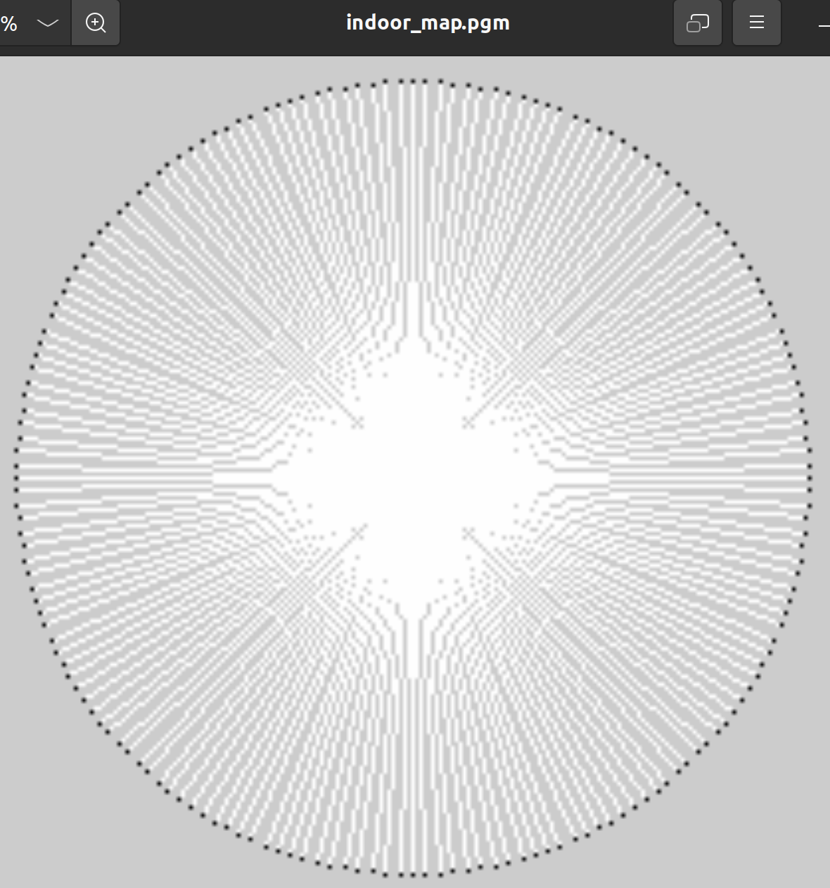

# 基于 ROS 的移动小车SLAM 建图与自主导航系统使用文档

| 项目名称 | 基于 ROS 的移动小车SLAM 与自主导航 |
| :--- | :--- |
| **项目成员** | 李响 (第四组) |
| **完成日期** | 2026年2月4日 |


---

## 目录

1.  [项目概述](#一-项目概述)
2.  [车辆软硬件环境说明](#二-车辆软硬件环境说明)
    * 2.1 硬件配置详解
    * 2.2 软件环境与依赖
3.  [实际操作流程与注意事项](#三-实际操作流程与注意事项)
    * 3.1 基础环境准备
    * 3.2 启动流程概览
    * 3.3 操作注意事项
4.  [核心算法的启动方法（重点）](#四-核心算法的启动方法重点)
    * 4.1 底层驱动与传感器数据的准备
    * 4.2 Gmapping 实时建图的操作流程
    * 4.3 Map Server 地图保存与管理
    * 4.4 AMCL 与 Move_base 自主导航的启动
5.  [核心参数及其对算法运行效果的影响](#五-核心参数及其对算法运行效果的影响)
    * 5.1 深度图转激光（Depthimage_to_laserscan）参数
    * 5.2 AMCL 定位粒子参数
    * 5.3 DWA 局部路径规划参数
6.  [系统最终运行效果应达到的状态](#六-系统最终运行效果应达到的状态)
7.  [实现过程中遇到的问题与解决方案](#七-实现过程中遇到的问题与解决方案)

---

<div style="page-break-after: always;"></div>

## 一、 项目概述

本项目旨在构建一个基于 ROS (Robot Operating System) Noetic 版本的移动机器人系统，能够在其工作环境中实现自主定位、环境地图构建（SLAM）以及自主路径规划与导航。

项目核心采用两轮差速移动底盘，配备 HP60C 深度相机作为主要感知传感器。通过 `depthimage_to_laserscan` 技术将深度信息转换为伪激光雷达数据，利用 Gmapping 算法完成室内环境的栅格地图构建，并最终基于 AMCL（自适应蒙特卡洛定位）和 Move_base 导航栈实现从起点到目标点的自主避障移动。

---

## 二、 车辆软硬件环境说明

### 2.1 硬件配置详解

本系统采用的硬件架构如下：

1.  **移动底盘**：
    * 类型：两轮差速驱动小车。
    * 功能：响应线速度 `v` 和角速度 `w` 指令，并提供底层里程计（Odometer）反馈。
    * 通信接口：USB 串口与上位机通信。
    

2.  **感知传感器**：
    * 型号：HP60C 深度相机。
    * 输出数据：RGB 彩色图像、Depth 深度图像。
    * 作用：替代传统激光雷达，通过软件转换获取环境轮廓信息。
    * *[此处建议插入图片：Week5 报告中相机拍摄的深度图效果]*

3.  **计算平台（上位机）**：
    * 设备：笔记本电脑 / 机载 PC。
    * 配置要求：支持 USB 3.0 接口（保证相机数据带宽）。

### 2.2 软件环境与依赖

系统运行在 Linux 环境下，具体配置如下：

* **操作系统**：Ubuntu 20.04 LTS (Focal Fossa)
    
* **ROS 版本**：ROS Noetic Ninjemys
* **开发工具**：Visual Studio Code, Terminator 终端
* **关键功能包依赖**：

| 功能包名称 | 作用 | 来源 |
| :--- | :--- | :--- |
| `ascamera_listener` | HP60C 深度相机驱动 | 厂商提供 |
| `depthimage_to_laserscan`| 将深度图转换为 2D 激光数据 | ROS 官方源 |
| `gmapping` | 基于粒子滤波的 SLAM 算法 | OpenSLAM |
| `amcl` | 概率定位算法 | Navigation Stack |
| `move_base` | 路径规划与运动控制核心 | Navigation Stack |
| `tf2_ros` | 坐标变换管理 | Geometry Stack |

> **环境检查命令**：
> 在开始前，请确保所有依赖已安装：
> ```bash
> rosdep update
> rosdep install --from-paths src --ignore-src -r -y
> ```

---

## 三、 实际操作流程与注意事项

### 3.1 基础环境准备

1.  **网络配置**：确保主控电脑与小车（如果是远程控制）处于同一局域网段下，并正确配置 `ROS_MASTER_URI` 和 `ROS_IP`。
2.  **权限赋予**：确保串口具有读写权限。
    ```bash
    sudo chmod 777 /dev/ttyUSB0
    ```
3.  **工作空间编译**：
    每次修改代码或配置文件后，必须重新编译并刷新环境变量：
    ```bash
    cd ~/catkin_ws
    catkin_make
    source devel/setup.bash
    ```

### 3.2 启动流程概览

整个系统的启动遵循严格的依赖顺序：
1.  启动 `roscore`（ROS 主节点）。
2.  启动底层驱动（小车串口驱动 + 相机驱动）。
3.  启动数据处理节点（TF 变换 + 深度转激光）。
4.  启动上层应用（建图 或 导航）。

### 3.3 操作注意事项

* **目录路径问题**（参考 Week 2 经验）：
    在运行命令或删除文件时，务必确认当前所处的终端路径。例如，删除地图文件时，必须进入文件所在目录，否则会报错 "No such file or directory"。
    > *错误示例*：在 `~/Desktop` 下尝试删除 `~/Downloads/week2.txt` 但未加路径。

* **TF 坐标系检查**（参考 Week 4/8 经验）：
    在启动算法前，必须使用 `rosrun tf view_frames` 检查坐标树是否完整。必须存在 `map -> odom -> base_link -> laser_frame` 的完整链路，任何一环断裂都会导致算法失效。

---

## 四、 核心算法的启动方法（重点）

本章节详细描述从零开始构建地图并进行导航的完整步骤。

### 4.1 第一阶段：驱动与数据转换

在进行任何高级操作前，必须先获取传感器数据。

**步骤 1：启动深度相机**
```bash
roslaunch ascamera_listener hp60c.launch
```
#### 验证：使用 rostopic hz /camera/depth/image_raw 查看是否有数据输出。

**步骤 2：启动深度转激光节点** 由于 Gmapping 和 AMCL 依赖 /scan 话题，我们需要运行转换节点。

```Bash
roslaunch depth2laser depthimage_to_laserscan.launch
该 Launch 文件内部核心配置如下（基于 Week 5 实验）：
```

```XML
<node pkg="depthimage_to_laserscan" type="depthimage_to_laserscan" name="depthimage_to_laserscan">
    <remap from="image" to="/camera/depth/image_raw"/>
    <param name="scan_height" value="10"/>
    <param name="range_min" value="0.2"/>
</node>
```

**步骤 3：启动 TF 变换与底盘驱动**

```Bash
roslaunch yhs_nav base_driver.launch
```


### 4.2 第二阶段：Gmapping 实时建图
#### 启动建图算法：

```Bash
roslaunch yhs_nav gmapping.launch
```
此命令将启动 slam_gmapping 节点，订阅 /scan 数据，并发布 /map 话题。

#### 可视化监控： 打开 RViz：

```Bash
rosrun rviz rviz
```
配置说明：

1. Fixed Frame 设置为 map。

2. Add -> RobotModel。

3. Add -> LaserScan (Topic: /scan)。

4. Add -> Map (Topic: /map)。

#### 控制移动： 使用键盘控制小车在房间内缓慢移动，尽可能覆盖所有区域。

```Bash
rosrun teleop_twist_keyboard teleop_twist_keyboard.py
```

技巧：转弯速度（angular z）建议控制在 0.2 rad/s 以下，防止图像撕裂。


保存地图： 当 RViz 中地图构建完整后，执行：

```Bash
rosrun map_server map_saver -f ~/catkin_ws/src/yhs_nav/maps/my_lab_map
```

系统将生成 my_lab_map.pgm 和 my_lab_map.yaml。

### 4.3 第三阶段：AMCL 与 Move_base 自主导航
#### 启动导航栈：

```Bash
roslaunch yhs_nav navigation.launch
```
该 launch 文件包含三个核心部分：

1. map_server：加载之前保存的地图。

2. amcl：启动蒙特卡洛定位。

3. move_base：加载代价地图（Costmap）和路径规划器（Planner）。

**初始化定位**： 在 RViz 中，点击顶部工具栏的 "2D Pose Estimate"，在地图上根据小车实际位置通过“点击+拖拽方向”来初始化定位。

- 现象：绿色的粒子云（Particle Cloud）会聚合到小车周围。

**发送导航目标**： 点击 "2D Nav Goal"，在地图上选择目标点。

- 现象：

    出现一条绿色的全局规划路径（Global Plan）。

    出现一条红/蓝色的短局部规划路径（Local Plan）。

    小车开始自主移动并避障。


## 五、 核心参数及其对算法运行效果的影响
在 Week 5 至 Week 9 的实验调试中，我们重点优化了以下参数，对系统性能提升显著。

### 5.1 深度转激光参数 (depthimage_to_laserscan)
- 参数：range_min (最小探测距离)

    原始值：0.45m

    优化值：0.20m

    影响分析：HP60C 相机在近距离处仍有一定有效深度。如果设置过大，小车在靠近墙壁（<45cm）时会认为前方无障碍物，导致碰撞。调整为 0.2m 后，近距离避障能力显著增强（参考 Week 5 实验）。

- 参数：scan_height (扫描高度行数)

    原始值：1

    优化值：10

    影响分析：仅取 1 行像素转换激光数据极不稳定，容易受到深度图噪点（NaN/Inf）影响。取中间 10 行像素的平均值后，生成的伪激光数据更加平滑连续，大大减少了建图时的“毛刺”现象（参考 Week 8 实验）。

### 5.2 AMCL 定位参数 (amcl.launch)
- 参数：min_particles / max_particles

    设定值：500 / 2000

    影响分析：粒子数决定了定位的精度和 CPU 负载。在 Week 9 实验中，我们发现将最大粒子数从 1000 提升至 2000 后，小车在快速旋转时的定位丢失情况减少了，重定位成功率提高。

### 5.3 DWA 局部规划参数 (dwa_local_planner_params.yaml)
- 参数：max_vel_x (最大线速度)

    设定值：0.5 m/s

    影响分析：速度过快会导致深度相机画面拖影，且刹车距离变长。经过测试，0.5 m/s 是在保证效率和安全下的最优值。

- 参数：inflation_radius (膨胀半径)

    设定值：0.3 m

    影响分析：此参数决定了障碍物周围的“危险区域”大小。设置过大导致狭窄通道无法通过（提示 Costmap empty），设置过小则容易发生剐蹭。

## 六、 系统最终运行效果应达到的状态
经过调试，系统在最终演示时应达到以下标准状态：

1. 建图质量：

- 生成的 .pgm 地图轮廓清晰，墙壁线条闭合。

- 无明显的重影（Double Vision）现象，说明里程计与建图算法同步良好。



2. 定位稳定性：

- 在 RViz 中，小车模型（Robot Model）与实际物理位置同步。

- 粒子云（红色箭头簇）紧密收敛在小车周围，且随运动平滑更新，无大幅跳变。


3. 导航精准度：

- 给定目标点后，全局路径规划（Global Planner）能够迅速生成避开黑色障碍区的路线。

- 小车沿路径平滑移动，遇到动态障碍物能触发局部重规划（Local Replanning）。

- 到达终点时，位置误差 < 10cm，角度误差 < 5°。

## 七、 实现过程中遇到的问题与解决方案
本章节汇总了实习期间遇到的关键技术难题及解决过程。

### 7.1 深度图转激光数据异常 (Week 5/8)
- 问题现象：/scan 话题有发布，但在 RViz 中显示为红色或报错，或者数据全是 inf。

- 原因分析：深度相机可能对着光滑地面或反光物体，导致深度值丢失；或者 TF 坐标系中没有 camera_depth_frame 到 base_link 的变换。

- 解决方案：

1. 调整 range_max 和 range_min 过滤无效数据。

2. 在 launch 文件中添加静态 TF 发布器：

```XML
<node pkg="tf2_ros" type="static_transform_publisher" name="base_to_camera" args="0.1 0 0.2 0 0 0 base_link camera_depth_frame" />
```
### 7.2 Gmapping 建图无地图数据 (Week 8)
- 问题现象：Gmapping 节点启动正常，但话题 /map 始终无数据，终端警告 Dropped 100% of messages。

- 原因分析：这是典型的 TF 树断裂问题。Gmapping 需要 odom -> base_link 的变换，而该变换通常由底盘驱动发布。如果底盘驱动未启动或时间戳不同步，就会丢包。

- 解决方案：

    1. 使用 rosrun tf view_frames 生成 PDF 排查断开的链路。

    2. 确保 use_sim_time 参数设置正确（实车设为 false，仿真设为 true）。

### 7.3 导航启动报错 "Costmap empty" (Week 9)
- 问题现象：启动 move_base 后，终端报错提示代价地图为空，无法规划路径。

- 原因分析：costmap_common_params.yaml 中配置的传感器话题名称与实际发布的话题不一致（例如配置文件写的是 /scan，但重映射后变成了 /base_scan）。

- 解决方案：

    1. 使用 rostopic list 确认当前激光雷达话题名。

    2. 修改 yaml 文件中的 observation_sources 和 topic 字段，确保一一对应。

### 7.4 依赖包缺失与编译错误 (Week 1/2)
- 问题现象：catkin_make 报错，提示找不到 geometry_msgs 或 openslam_gmapping。

- 原因分析：ROS 安装不完整或源码包缺少依赖。

- 解决方案：

    1. 手动安装缺失包：sudo apt install ros-noetic-geometry-msgs。

    2. 在 CMakeLists.txt 和 package.xml 中补全依赖声明。

